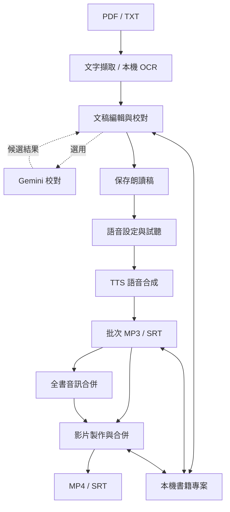

# ebook2mp4

## 功能簡介

Windows 桌面工具，將 PDF 或 TXT 書稿整理成朗讀音訊、字幕與影片。

- 匯入多份文件或 PDF 指定頁面，使用文字擷取或本機 OCR，並核對來源與編輯文稿。
- 人工校對，或選用 Gemini 協助校對；保存朗讀稿及專案版本。
- 設定語音並試聽，製作各批次 MP3 和 SRT；支援中斷後續作。
- 排序及合併批次音訊、檢查交接處，並以統一素材或既有批次影片製作全書 MP4。
- 在程式內播放、另存成品；重新啟動時載入上次開啟的專案。

## 系統使用技術與架構圖

- **桌面介面與工作流程**：Python、Tkinter；專案以本機檔案及 `project.json` 保存。
- **文件處理**：PDFium／pypdfium2、Pillow、Tesseract OCR；OpenCC 處理繁簡轉換。
- **校對與語音**：選用 Gemini 校對；語音支援 Edge TTS、Gemini TTS、Fish 及本機 Kokoro，依服務需求設定網路、金鑰或語音資源。
- **媒體與封裝**：FFmpeg／FFprobe 處理音訊、字幕及影片；PyInstaller 封裝 Windows 程式。



## 如何安裝和使用流程

### 安裝與啟動

1. 準備 Windows 封裝成品，將整個 `dist/ebook2mp4` 資料夾複製到要使用的位置，保留其中的 `_internal` 資料夾。
2. 執行 `ebook2mp4.exe`。封裝版不需要另行安裝 Python；需要 OCR 時，可依程式提示下載缺少的模型。
3. 使用線上校對或語音服務時，依所選服務設定網路與憑證；本機 Kokoro 語音依程式提示準備語音資源。

若從原始碼執行，請準備含 Tkinter 的 Python 3.11 以上版本，在專案目錄建立並啟用虛擬環境，再安裝執行依賴並啟動：

```powershell
python -m venv .venv
.\.venv\Scripts\Activate.ps1
python -m pip install -r packaging/requirements-runtime.txt
python -m ebook2mp4
```

從原始碼使用 OCR、音訊或影片功能，還需準備對應的 Tesseract、OCR 模型及 FFmpeg 工具；封裝準備方式見 [packaging](packaging)。

### 使用流程

1. 開啟程式，建立書籍專案，或從「專案」開啟既有專案。
2. 匯入 TXT 或 PDF；PDF 可選擇頁面範圍，必要時使用 OCR，並核對及處理來源異常。
3. 在「1 文稿」編輯文字，視需要使用校對工具，完成後按「儲存為朗讀稿」，再前往試聽與製作。
4. 選擇語音服務、音色與語速，試聽後製作批次 MP3／SRT。線上服務送出文字前請確認同意。
5. 需要全書音訊時，進入「全書合併」，選擇並排序批次、設定停頓、檢查接點，再製作合併音訊。
6. 進入「影片製作」，選擇本批或全書及所需素材，製作 MP4；完成後可播放、另存或開啟成品資料夾。
