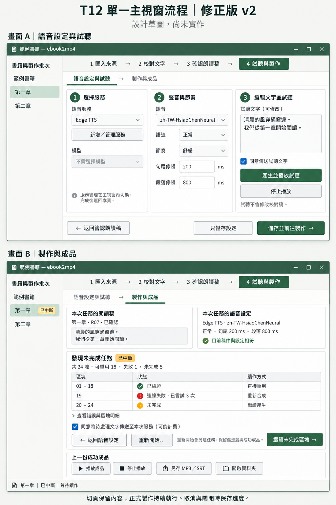
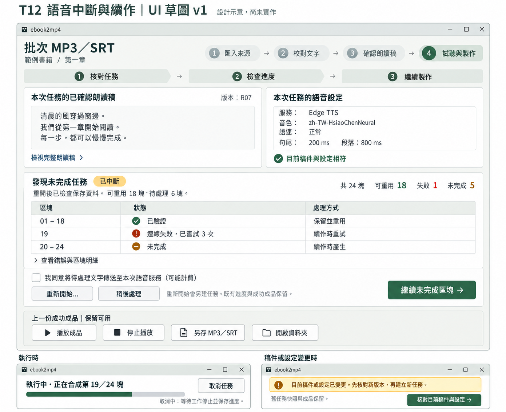

# T12：語音斷網、取消及重開後重用有效區塊

狀態：使用者已核准 v2 並指示實作。實作、證據與待人工驗收項目見 [T12 驗證](verification/T12.md)。以下保留原設計提案與驗收規則。

## 修正版 v2：單一主視窗

本圖用內建 imagegen 產生，兩個畫面表示同一主視窗的不同頁面，不是同時開啟兩個視窗。圖中文字若與此文件不同，以明確按鈕名稱及行為規則為準。語音欄位實作時維持「音色」稱呼，沿用既有自然／舒緩／自訂節奏數值，不以草圖數字覆寫既有預設。

使用者同意先畫單一主視窗修正版；尚未同意開始寫程式。v2 取代 v1 的獨立製作視窗配置，T12 的資料完整性與續作驗收仍沿用下文。

保留主視窗的四步驟導航與左側書籍／批次清單。「試聽與製作」直接顯示內頁，不開啟 VoiceDialog 或 NarrationDialog。內容區提供「語音設定與試聽 → 製作與成品」兩頁；前進按鈕先成功儲存設定，再切頁。返回不重建頁面、不丟失未存設定或試聽文字。「新增／管理服務」也在同一內容區切換，返回時保留原頁輸入。原生選檔／另存對話框仍按需要開啟。

進入語音設定頁時，先由左至右選服務、聲音與節奏、編輯並試聽，再往下儲存並前往製作。進入製作頁時，先核對快照，再檢查進度，再開始／續作，最後檢查成功成品。未確認朗讀稿仍可短文試聽，但正式製作按鈕須提示先完成朗讀確認。

頁面切換與任務生命週期分開。正式製作持續執行，底部狀態列顯示所屬批次、階段與完成數，並可返回該任務。切換批次不得將執行中的任務歸給新批次；同專案排他限制繼續生效。稿件或設定變更不能改寫執行中的快照。未存設定離頁保留，但切換書籍／批次時須明確處理未存內容，不可把 A 批次的設定套到 B 批次。試聽播放離頁停止；正在產生的試聽維持原批次與原文字快照，背景完成不自動播放，回頁後可手動播放。

關閉應用程式時先取消並等待工作停止、保存有效進度，再釋放播放、連線、媒體程序、鎖與計時器。切頁不可重複註冊輪詢或漏掉清理。

追加驗收路徑：

| ID | 測試路徑 | 通過條件 |
| --- | --- | --- |
| S01 單一主視窗 | 按「試聽與製作」→ 按「儲存並前往製作」→ 按「返回語音設定」 | 同一主視窗切換內容。沒有新增流程視窗。 |
| S02 保留輸入 | 修改試聽文字與設定 → 切到製作頁 → 返回設定頁 | 試聽文字及設定保留。儲存失敗不得前進。 |
| S03 背景製作 | 開始製作 → 返回校對頁 → 檢查底部狀態 → 返回製作頁 | 任務持續執行。階段與進度正確。沒有重複啟動。 |
| S04 批次隔離 | 在 A 批次開始製作 → 選擇 B 批次 → 檢查設定與任務狀態 → 返回 A | B 不顯示為 A 任務的擁有者。A 快照不變。排他限制有效。 |
| S05 內頁管理服務 | 修改試聽文字 → 按「新增／管理服務」→ 返回語音設定 | 沒有新增服務視窗。原文字與未存設定保留。 |
| S06 離頁播放 | 開始播放試聽 → 返回其他頁 → 返回設定頁 | 離頁停止播放。成功試聽結果保留。背景完成不自行發聲。 |
| S07 關閉與續作 | 製作中關閉程式 → 等待正常退出 → 重開專案 → 進入製作頁 → 續作 | 保存有效區塊。沒有本次殘留程序或占用。主視窗可續作。 |

以下為 v1 的功能規則與驗收基礎；出現「製作視窗」時，在 v2 應理解為主視窗內的「製作與成品」頁。

草圖以內建 imagegen 產生。圖中未勾選同意時的綠色按鈕僅示意主要動作位置；實作時須依下表停用。下方進度條僅表示區塊數，不表示整體完成比例；最終介面以階段及完成數為主。

依據：`docs/implementation-status.md` 最新交接、`.scratch/pdf-txt-audiobook-video/v1.1/issues/12-audio-interruption-resume.md`、Spec v1.1 需求 17／18。T12 使用本機核定票稿，沒有將 T12 推定為 GitHub issue #12。

## 操作順序

沿用主介面「匯入來源 → 校對文字 → 確認朗讀稿 → 試聽與製作」。從語音設定進入批次 MP3／SRT，或開啟專案後，由目前批次的未完成任務提示進入。

製作視窗由上而下排列：核對任務 → 檢查進度 → 繼續製作 → 檢查成品。頂部左右並列本次任務的唯讀朗讀稿與語音設定。底部固定主要操作；內容不足時垂直捲動。狹窄視窗將左右兩欄改為上下排列。鍵盤焦點順序遵循閱讀順序。圖片上的數字均為範例。

## 狀態與按鈕

| 條件 | 畫面 | 主要操作 |
| --- | --- | --- |
| 尚無任務 | 已確認稿、語音設定、送出同意 | 開始製作 MP3／SRT |
| 已取消、失敗或重開辨識中斷 | 原任務快照、驗證後可重用數、待處理數、錯誤 | 繼續未完成區塊 |
| 等待 | 顯示等待階段 | 取消任務 |
| 執行中 | 顯示合成／驗證／組裝／發布階段與區塊數 | 取消任務 |
| 取消中 | 顯示等待停止與保存進度 | 等待停止；停用重複啟動 |
| 稿件或設定改變 | 顯示差異原因；停用舊任務續作 | 核對目前稿件與設定 |
| 所有語音區塊有效、組裝未完成 | 顯示重用全部區塊，繼續組裝 | 繼續製作 MP3／SRT |
| 完成 | MP3、SRT 皆驗證及發布成功 | 播放成品 |

「已中斷」是重開時的恢復提示，不能把仍在其他視窗執行的任務判為中斷。「取消中」尚未等同「已取消」。未知耗時不顯示預估完成時間；區塊數不冒充整體工作百分比。

「重新開始…」先顯示將採用的稿件與設定，再另建任務。保留舊進度與成功成品。設定一致且驗證通過的原始音訊仍可重用；不提供強制清除快取的隱含動作。稿件變更需重新確認朗讀稿後才能建立新任務。T13 的跨版本增量製作不納入 T12。

同意欄只涵蓋本次待傳送文字與所選服務。取消勾選時停用會傳送文字的開始／續作操作。全部音訊可重用且只需本機組裝時，明示「本次不傳送文字」，不要求線上同意。

區塊明細預設收合，顯示失敗原因與有限重試次數。成功成品操作獨立於新任務進度；失敗時仍可播放上一份成功成品。恢復流程自行安全處理中斷鎖，不要求使用者手動刪檔。

## 驗收方式

以下使用繁體中文，採 ASD-STE100 程序寫作原則：短句、命令句、每句一個動作、先說條件、依執行順序排列。這是中文驗收表，不宣稱符合英文詞彙標準。參考：[ASD-STE100 Issue 9，第 5 節](https://www.asd-ste100.org/assets/files/ASD-STE100_ISSUE9.pdf)。

共用前置條件：使用合成測試文字建立暫存專案。確認朗讀稿。儲存語音設定。準備至少 6 個區塊。需檢查舊成品的案例，先產生一份成功 MP3／SRT。

| ID | 測試路徑 | 通過條件 |
| --- | --- | --- |
| A01 操作順序 | 開啟專案 → 選擇批次 → 按「試聽與製作」→ 開啟「批次 MP3／SRT」→ 依序核對稿件、設定與進度 | 閱讀及鍵盤順序由左至右、由上至下。主要按鈕清楚可見。未完成任務可從提示進入。 |
| A02 正常完成 | 勾選同意 → 按「開始製作 MP3／SRT」→ 檢查狀態 → 等待發布 → 按「播放成品」→ 按「開啟資料夾」 | 任務依序顯示等待、執行中、完成。MP3 可完整解碼。SRT 時間對應實際音訊。 |
| A03 有限重試 | 開始製作 → 讓中段區塊持續連線失敗 → 檢查嘗試次數 → 檢查任務狀態 | 該區塊最多嘗試 3 次。保存錯誤與已成功區塊。不得顯示完整成功。 |
| A04 取消與重開 | 開始製作 → 等待部分區塊成功 → 按「取消任務」→ 等待「已取消」→ 關閉專案 → 重開專案 | 顯示取消中及已取消。重開可見保存進度。既有成功成品保留。 |
| A05 中段斷網後續作 | 開始製作 → 在中段斷網 → 按「取消任務」→ 關閉專案 → 恢復網路 → 重開專案 → 核對原任務 → 勾選同意 → 按「繼續未完成區塊」 | 只請求缺少、失敗或驗證不通過的區塊。已驗證且設定一致的成功區塊請求數為 0。 |
| A06 程序中斷 | 開始製作 → 等待部分區塊保存 → 結束本次測試程序 → 重開專案 → 按「繼續未完成區塊」 | 辨識中斷。保留最後有效進度。無須手動刪鎖。未驗證的殘檔不得重用。 |
| A07 損壞或缺少區塊 | 取消任務 → 關閉專案 → 刪除一個成功區塊 → 截斷另一個成功區塊 → 重開專案 → 續作 | 重新驗證區塊。只重做無效項目。明細說明失效原因。完整有效項目不重請。 |
| A08 執行中改稿 | 開始製作 → 回校對頁修改稿件 → 儲存稿件 → 等待原任務停止 → 檢查原任務快照 → 嘗試續作 | 執行中的任務保持原稿與原設定。畫面標示版本不同。舊任務不能混入新稿或冒充目前有效成品。 |
| A09 設定改變 | 取消任務 → 修改音色、模型、服務或節奏 → 儲存設定 → 重開製作視窗 → 按「核對目前稿件與設定」 | 舊設定不能直接續作。新任務明示新設定。舊進度與成品保留。 |
| A10 重新開始 | 開啟未完成任務 → 按「重新開始…」→ 取消確認 → 檢查舊任務 → 再按「重新開始…」→ 確認新任務 | 取消不改資料。確認後另建任務。舊任務與成品仍可找回。 |
| A11 組裝取消 | 等待全部區塊成功 → 在組裝階段按「取消任務」→ 重開專案 → 續作 | 舊 MP3／SRT 保持原雜湊。續作重用全部有效區塊。本機組裝新增 TTS 請求數為 0。 |
| A12 磁碟不足 | 保留成功成品 → 在新任務組裝或發布時注入空間不足 → 檢查錯誤 → 播放舊成品 → 釋出測試空間 → 續作 | 顯示可操作錯誤。舊 MP3／SRT 均完整。半成品不得標示完成。 |
| A13 跨視窗排他 | 在視窗 A 開始製作 → 在視窗 B 開啟同專案 → 嘗試開始或續作 → 停止 A 的任務 → 重開 B | B 提示已有製作任務。B 不搶鎖或誤判中斷。A 停止後可正常繼續。 |
| A14 同意與離線組裝 | 取消勾選同意 → 嘗試需要合成的續作 → 檢查請求 → 切換至全部音訊有效的任務 → 離線繼續組裝 | 未同意時新增 TTS 請求數為 0。全部有效時可離線組裝。畫面明示不傳送文字。 |
| A15 視窗與資源 | 調小視窗 → 逐項按 Tab → 開始任務 → 捲動內容 → 按取消 → 關閉視窗 → 重開專案 | 控制項不裁切、不重疊。介面可回應。停止後釋放本次連線、播放、媒體程序、鎖與計時器。 |

A03、A06、A07、A11、A12、A13 以可控制的整合故障驗證。A05 另以真實服務短篇測試；只使用合成文字。音訊及字幕用真實 FFmpeg／FFprobe 檢查。替身結果與真實結果分開記錄，不以模擬通過代替線上服務或人工聽感驗收。

## 後續工作

使用者說 OK 後才修改產品程式。沿用公開 ProjectWorkflow 與真實 Tk 邊界做 TDD，定期執行相關單檔測試及型別檢查。完成後執行完整測試及 code-review 雙軸審查。依 implement 指示提交目前分支；只納入本次可確認的變更，不推送。現有未提交修改很多，須先界定本次差異。

本階段保留草圖與本文件。未啟動產品、測試、建置或網路服務程序。繪圖工具若產生中間檔，僅保留最終預覽。實作階段結束時清理本次暫存與程序；正式區塊快取是續作資料，不得當作暫存刪除。

目前可在本 session 繼續；實作與完整驗證需要較長上下文。接近上限時先寫交接，再提醒使用者換 session。
