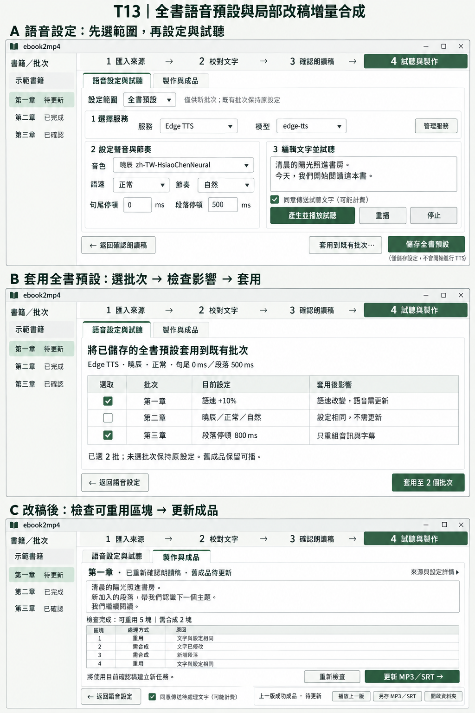

# T13：全書語音預設與局部改稿增量合成

狀態：使用者已指示開始實作，並更新為「依照目前版面延伸，不用重新設計」。以下 A／B／C 圖只保留為功能討論紀錄，不能視為重排既有介面的核准。實際保留目前服務列、左右設定／試聽區與底部範圍／操作列；必要的新入口在既有底部操作列，批次套用於同視窗內頁完成。實際結果與操作路徑見 [T13 驗證](verification/T13.md)，與以下歷史提案不同時以實作驗證文件為準。

依據：本機核定票稿 `.scratch/pdf-txt-audiobook-video/v1.1/issues/13-incremental-audio-book-defaults.md`、Spec v1.1 AC-17／AC-24／AC-25、`GLOSSARY.md`、`DESIGN.md` 與最新交接。T13 是本機票號，不推定為 GitHub issue #13。

## 設計圖

圖為設計示意，不是已完成的產品畫面。圖中批次、文字及區塊數是範例。圖中文字若有繪圖誤差，以本文的名稱和行為為準。三個畫面表示同一主視窗依序切換內容，不是同時開三個視窗。

## A：語音設定與試聽

保留四步驟主導航、左側書籍／批次清單，以及「語音設定與試聽 → 製作與成品」內頁。設定範圍移到內容頂端，先選「本批次」或「全書預設」，再依序選服務／模型、聲音／節奏、試聽。沿用既有服務限定欄位與模型可選可填行為。

- 選「本批次」：顯示該批次實際保存設定。提供「載入全書預設」，只填入表單，按儲存才生效。底部為「儲存本批次設定」及「儲存並前往製作 →」。
- 選「全書預設」：顯示「僅供新批次；既有批次保持原設定」。底部為「套用到既有批次…」及「儲存全書預設」。不顯示含糊的製作動作。
- 新批次建立時複製當時預設。既有批次不持續連動全書預設。
- 範圍切換保留兩份各自的未存輸入，明示尚未儲存。切換書籍／批次沿用既有未存資料保護，不能把 A 的輸入帶入 B。
- 「套用到既有批次…」只使用已儲存預設。若表單有未存變更，先提示儲存或返回編輯，不默默採用另一版本。

## B：套用到既有批次

在同一內容區顯示「將已儲存的全書預設套用到既有批次」。頂部一列摘要；中間為可勾選批次表。所有批次起初均不勾選。欄位為選取、批次、目前設定、套用後影響。詳情按需查看。底部左側返回，右側「套用至 N 個批次」；未選時停用。返回保留原語音頁輸入。

選取後先顯示影響，再由使用者按套用。只儲存指定批次設定，不自動合成，不傳送文字。套用成功後仍留在本頁，列出結果；返回語音頁可切換批次製作。相同設定視為不需更新，不造成假失效。同專案製作忙碌時停用會衝突的套用操作並說明原因。

影響依實際計畫判定：音色／語速／服務／模型變更須使用對應語音；停頓只影響組裝時可重用原音，若改變切分則需更新必要區塊。檢查前不承諾固定重用數。未選批次的設定、確認狀態及成品均不變。設定變更不要求重做人工文字校對，但正式製作須核對目前稿件與設定。舊成品保留並標示待更新。

## C：增量製作與成品

局部改稿儲存後，只取消該批的朗讀確認。舊成品標「待更新」，可繼續播放／另存。使用者完成「確認朗讀稿」後，進入製作頁。先檢查原音有效性及新計畫，再顯示「可重用 N 塊｜需合成 M 塊」。檢查中顯示處理狀態並停用開始操作，不把尚未驗證的數量當成確定結果。

保留目前朗讀稿預覽、區塊清單及底部固定操作。區塊標示重用／需合成與簡短原因。技術雜湊、完整設定及來源版本放在「來源與設定詳情」。舊成品顯示來源時間及舊設定摘要，避免誤認為目前版本。標頭摘要不放長篇技術資訊。

- 需要外部合成：主操作「更新 MP3／SRT →」，同意預設勾選；取消勾選即阻止送出。
- 全部原音有效：主操作「重新組裝 MP3／SRT →」，顯示「本次不傳送文字」，可離線完成。
- 尚未重新確認：提示「請先確認目前朗讀稿」，主操作導回確認頁，不能合成。
- 舊任務稿件／設定不同：不能直接續作；核對目前版本後另建新任務，從內容快取重用有效原音。相同快照的中斷續作沿用 T12。
- 更新中：顯示目前階段及已完成／總區塊；出現取消操作。取消中等待資源釋放後才允許再次製作。
- 成功：新 MP3／SRT 完整驗證後才發布。失敗或取消不得破壞上一版成功成品。

原音重用以實際文字、服務／模型／音色／語速及相關規則識別；不依整稿版本、區塊順序或檔名判定。插入段落後，位置改變但內容與設定相同的有效區塊仍可重用。切分受影響的相鄰區塊可能需要重做，不宣稱每次只合成一塊。

主程式啟動最大化。驗收至少包含還原至 1040×640、1360×800 及最大化；保持必要操作可見。書籍清單、稿件和區塊表各自捲動，不加入整頁外層捲動或水平捲動。窄版允許操作列換行，仍保持返回在前、主要下一步在後。鍵盤順序跟隨畫面順序。

## 驗收路徑

以下採 ASD-STE100 的程序寫作風格：短句、單一動作及可觀察結果。這是中文驗收程序，不宣稱符合英文受控詞彙標準。以下均為待執行驗收，不是測試通過紀錄。

前置：建立合成文字測試書籍。準備 A、B、C 三個批次。A、B 各有成功 MP3／SRT。保存原設定與成品雜湊。外部 TTS 替身記錄每次送出內容；最終媒體使用真實 FFmpeg／FFprobe 驗證。真實服務短文測試另列，不送使用者書稿。

| ID | 測試路徑 | 通過條件 |
| --- | --- | --- |
| V01 新批次預設 | 按「試聽與製作」→ 選「全書預設」→ 修改音色、語速與停頓 → 按「儲存全書預設」→ 新增批次 D → 開啟 D 的語音設定 | D 採用新預設。A、B、C 保留原設定。重開專案後結果相同。 |
| V02 個別覆寫 | 選 D → 選「本批次」→ 修改語速 → 按「儲存本批次設定」→ 重開專案 → 檢查 D → 檢查全書預設 | D 保存自己的語速。全書預設不變。其他批次不變。 |
| V03 明確套用 | 儲存全書預設 → 按「套用到既有批次…」→ 只勾 A、C → 檢查影響 → 按「套用至 2 個批次」→ 重開專案 | 只有 A、C 設定更新。B 不變。沒有 TTS 請求。舊成品保留。 |
| V04 無變化與返回 | 開啟套用頁 → 勾選設定相同的批次 → 檢查影響 → 按返回 → 檢查原頁輸入 | 顯示不需更新。沒有假失效。返回不套用、不丟輸入。 |
| V05 局部改稿 | 選 A → 修改一段校對稿 → 儲存 → 檢查確認狀態 → 檢查 B → 播放 A 上一版成品 | 只有 A 需重新確認。A 舊成品標待更新且可播。B 的稿件、確認及成品不變。 |
| V06 修改後更新 | 重新確認 A → 前往製作 → 等待區塊檢查 → 核對計畫 → 按「更新 MP3／SRT →」→ 檢查請求紀錄 → 播放新成品 | 只送出失效區塊。有效區塊請求數為 0。新音訊及字幕涵蓋完整新稿。 |
| V07 插入段落 | 在 A 中段新增一段 → 儲存並確認 → 更新 MP3／SRT → 檢查請求文字 → 檢查最終段落順序 | 位置改變的有效區塊仍重用。沒有遺漏或重複段落。新增及必要重切區塊才重請。 |
| V08 音色與語速隔離 | 更換 A 音色 → 儲存並更新 → 更換 A 語速 → 再次更新 → 檢查請求及成品 | 不混用不同音色／語速原音。服務／模型變更也依同一原則驗證。 |
| V09 停頓變更 | 只改段落停頓 → 更新成品 → 檢查請求數與靜音 → 改非零句尾停頓 → 更新成品 | 切分不變時無新請求。切分改變時只重做必要區塊。停頓按實測插入。新增靜音沒有字幕。 |
| V10 取消與失敗 | 啟動新版本更新 → 按「取消任務」→ 等待已取消 → 播放上一版 → 注入合成或組裝失敗 → 檢查舊檔 → 重開續作 | 舊 MP3／SRT 雜湊不變。錯誤可見。續作只重做無效區塊。 |
| V11 同意與離線 | 取消勾選同意 → 嘗試需合成的更新 → 檢查請求數 → 準備全部原音有效的計畫 → 離線重新組裝 | 未同意時請求數為 0。全重用時顯示不傳送文字，離線可完成。 |
| V12 損壞快取 | 關閉測試專案 → 截斷一個原音檔 → 重開 → 重新檢查 → 更新 | 損壞原音不重用。只重請必要區塊。新成品完整解碼。 |
| V13 操作與尺寸 | 啟動程式 → 還原到 1040×640 → 按 Tab 走過三頁 → 調整至 1360×800 → 最大化 → 捲動清單 | 啟動最大化。文字不重疊。按鈕不裁切。主要操作保持可見。沒有雙層或水平捲動。 |
| V14 資源釋放 | 製作中取消 → 等待停止 → 關閉程式 → 檢查本次程序與鎖 → 獨占開啟並釋放成品檔 → 清理測試資料 | 沒有本次殘留程序或占用。正式成品、需求、證據及正式續作原音保留。 |

## 核准後的工作

使用者確認後才進入產品實作。依 implement 使用 TDD，沿用公開 ProjectWorkflow 與真實 Tk 行為邊界。定期跑相關單檔測試及型別檢查，最後跑完整測試。完成後依 code-review 作 Standards／Spec 雙軸審查，再提交目前分支，不推送。測試請求數、完整內容及時間軸，不以畫面顯示的重用數代替真正重用。

此輪僅保留設計圖及需求／驗收文件。不啟動產品、測試、建置或媒體程序。實作告一段落時刪除本次測試資料、建置暫存及測試快取，確認工作程序與資源釋放。正式 `voice-blocks` 是續作資料，不當作暫存刪除。

目前尚不需更換 session。接近上下文上限時，先更新交接文件，再提醒使用者換新 session。
