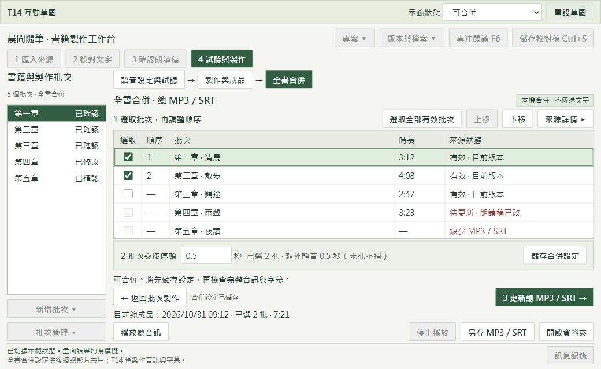

# T14：共用全書合併設定，產生總 MP3／SRT

狀態：使用者已說 OK，核准依此草圖實作。HTML 保留為設計依據；實作與驗證進度見交接文件。

依據：本機票稿 `.scratch/pdf-txt-audiobook-video/v1.1/issues/14-total-audio-shared-assembly.md`、最新交接及 T13 實際版面。T14 是本機票號，不推定為遠端 issue #14。

## 草圖

[開啟互動 HTML](mock-ui/t14-total-audio-v1/index.html)。可直接以瀏覽器開啟，不需安裝依賴或啟動服務。使用合成範例，不讀取實際書籍。桌面原生程式才是正式實作目標。

保留目前背景色、綠色主操作、中文字體、四步驟導航、左側書籍批次與底部訊息。原本「語音設定與試聽 → 製作與成品」後加入「全書合併」。不重排原本兩個頁面。全書頁顯示目前書籍的合併設定，不因左側單批選取而建立不同合併清單。

在同一頁由上往下依序操作：

1. 勾選批次。點選一列，再按上移／下移調整所選順序。未選批次沒有順序。排序只影響全書合併，不改左側書籍批次順序。
2. 設定額外交接停頓。預設 0.5 秒，提供常用候選並允許手填非負秒數。顯示選取批數與額外靜音合計；N 批加 N−1 段，不在末批後補靜音。
3. 按「製作總 MP3／SRT」或「更新總 MP3／SRT」。先保存目前清單，再檢查來源並固定任務快照。另有獨立「儲存合併設定」，不必開始製作即可保存。

新書尚未保存合併設定時，正式版初始不勾選任何批次；草圖起始兩批已選，代表已有保存設定的書籍。重開保留批次識別、版本、順序與交接停頓。此設定供後續總影片共用，T14 不放尚未實作的影片輸出控制項。

清單列出目前有效、稿件變更、缺少 MP3／SRT 及損壞來源。不能新勾無效來源；已保存選取若變無效，保留該列與原因，阻止合併，允許取消選取或前往該批次製作。只驗證已選來源來決定能否開始，未選無效批次不阻擋。

「來源詳情」在同一內容區取代清單，可返回，不開新視窗。放置來源版本、朗讀稿／設定一致性及時間軸說明。正式版開始前完整檢查可解碼音訊與有效字幕；草圖顯示的有效狀態只是示例。

進度與取消只在執行中出現。製作中固定選取、順序與停頓，停用會衝突的儲存／製作操作。切換內頁不停止正式任務；跨頁播放停止。取消須等程序釋放後才回到可操作狀態。失敗顯示原因並提供有限重試；正式版每次任務最多 3 次自動嘗試，使用者明確重試另啟動新任務，不無限循環。

底部保留成品摘要、播放／停止、另存與開啟資料夾。設定或已選來源變更時顯示「待更新 · 上一版總成品」。舊成品仍可播；僅在新成品完整驗證並發布後替換。未選批次、圖片及視覺設定不使總音訊失效。合併不新增 TTS 請求，無需文字傳送同意欄。

## 草圖檢查

2026-10-31 已用實際瀏覽器檢查。1040×640、1360×800 的文件寬高均等於視窗寬高，沒有整頁捲動；1040×640 的可見按鈕、選單及輸入框皆在視窗內。清單與詳情各自捲動，兩者不疊加。保留 [失效狀態圖](mock-ui/t14-total-audio-v1/preview-invalid.jpg)。

已操作：選第三批、上移、保存、重載，順序為第一／第三／第二，額外交接共 1 秒；取消失效第二批後恢復可製作，該來源仍顯示損壞；模擬取消先顯示釋放中，再顯示已取消；其他任務忙碌時，製作與保存皆停用。

以上僅為 HTML 草圖驗證，不代表原生 Tk、真實媒體、字幕時間軸、磁碟保護、零 TTS 或跨程序鎖已驗收。其他 DPI 與原生最小尺寸待產品實作時驗證。

## 實作後的驗收路徑

以下是 ASD-STE100 風格的中文程序：短句、單一動作、可觀察結果。不是已通過的產品測試，也不宣稱符合英文受控詞彙標準。準備合成範例書籍及 A、B、C 三批有效 MP3／SRT，使用真實 FFmpeg／FFprobe 驗證媒體，另記錄 TTS 請求數。

| ID | 操作路徑 | 確認結果 |
| --- | --- | --- |
| V01 保存順序 | 按「試聽與製作」→ 按「全書合併」→ 勾 A、C → 點 C 列 → 按「上移」→ 按「儲存合併設定」→ 重開專案 | 順序為 C、A。B 未選。來源版本及停頓保存。 |
| V02 純音訊 | 使用沒有圖片、背景及批次 MP4 的書籍 → 選有效來源 → 按「製作總 MP3／SRT」→ 檢查成品及請求記錄 | 總音訊與字幕完成。新增 TTS 請求為 0。 |
| V03 無效來源 | 選擇缺少、過期或損壞來源的範例 → 開啟全書合併 → 按「來源詳情」 | 逐列顯示原因。不能開始。取消失效選取後恢復；未選失效批次不阻擋。 |
| V04 單批交接 | 只選 A → 使用 0.5 秒 → 製作 → 完整解碼成品 | 不增加交接靜音。原有頭尾保留。 |
| V05 兩批交接 | 選 A、B → 使用 0.5 秒 → 製作 → 量測時間及字幕 | 額外增加 500 ms。只加一段。新增靜音沒有字幕。 |
| V06 三批交接 | 選 A、B、C → 使用 0.5 秒 → 製作 → 量測時間及字幕 | 額外增加 1,000 ms。末批後不補停頓。 |
| V07 真實時間軸 | 合併具有不同 MP3 編碼延遲的來源 → 完整解碼 → 檢查每段字幕起迄 | 依實際時間偏移。字幕非負、依序且不重疊。結尾不超出音訊 200 ms。 |
| V08 設定變更 | 完成總成品 → 改順序或交接停頓 → 保存 → 播放上一版 → 重開專案 | 顯示待更新。舊成品仍可播。重開保留狀態。 |
| V09 來源影響 | 更新已選 A 的稿件或語音 → 檢查總成品 → 還原有效來源 → 更新未選批次或視覺設定 → 再檢查 | 已選來源變更會待更新。未選批次與視覺變更不影響總音訊。 |
| V10 取消與快照 | 開始合併 → 檢查選取及排序控制項 → 切換內頁 → 返回 → 按「取消任務」→ 等待已取消 → 播放舊版 | 任務使用固定快照。衝突操作停用。取消後舊成品完整。 |
| V11 失敗保護 | 注入讀檔失敗或磁碟不足 → 開始合併 → 等待失敗 → 檢查舊成品雜湊及進度 → 解決原因 → 明確重試 | 原因可見。嘗試次數有限。保留舊成果與可驗證進度；不要求本張提供任意位置續作。 |
| V12 排他 | 在同專案開始批次製作 → 開啟全書合併 → 嘗試開始 → 另開同專案視窗 → 再嘗試 | 同專案同時只有一個產出任務。兩個入口均有保護。 |
| V13 成品操作 | 合併成功 → 按「播放總音訊」→ 按「停止播放」→ 按「另存 MP3／SRT」→ 按「開啟資料夾」 | 播放可停止。另存兩檔可讀。資料夾指向正確版本。 |
| V14 尺寸與釋放 | 啟動程式 → 還原到 1040×640 → 依 Tab 操作 → 調至 1360×800 → 最大化 → 取消並關閉 → 獨占開啟並釋放成品 | 啟動最大化。無裁切、重疊或水平／雙層捲動。沒有本次殘留程序、鎖或占用。 |

## 下一步及收尾

使用者確認草圖後才實作。依 implement 在公開工作流程與真實媒體邊界採 TDD，定期執行相關單檔與型別檢查，最後跑完整測試。完成後用 code-review 進行 Standards／Spec 審查並提交目前分支，不推送。

本輪保留 HTML、兩張預覽及本提案。預覽 HTTP 服務於交付前停止，不保留測試或媒體程序。正式書籍、dist、原音續作資料及使用者正在使用的 T13 程式不動。尚不需更換 session；若實作時接近上下文上限，先更新交接再提醒。
