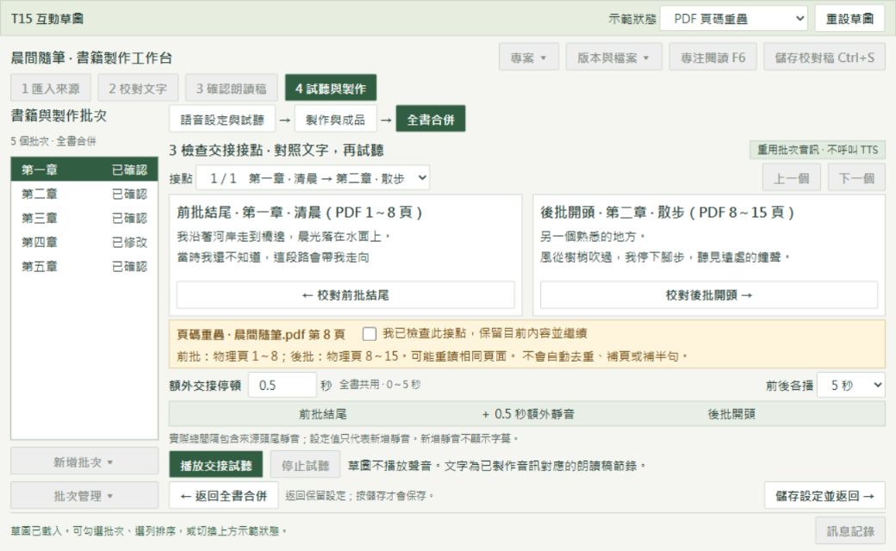

# T15：交接停頓、接點試聽與頁碼檢查

狀態：使用者已說 OK，核准依本草圖實作。HTML 保留為設計依據；正式驗證另記錄。

依據：本機票稿 `.scratch/pdf-txt-audiobook-video/v1.1/issues/15-audio-join-preview-page-warnings.md`、交接文件、T14 原生畫面與現有 `assembly_desktop.py`。T15 是本機票號，不推定遠端 issue #15。

[開啟互動 HTML](mock-ui/t15-join-preview-v1/index.html)。可直接以瀏覽器開啟，不需要啟動服務。使用虛構範例。試聽與製作均為無聲模擬，不讀取書籍、不呼叫 TTS。

## 版面及操作

沿用目前背景、中文字體、綠色主操作、四步驟導航、左側批次、製作內頁與底部訊息。全書合併由上到下依序為「1 選取及排序 → 2 額外交接停頓 → 3 接點檢查 → 4 製作總 MP3／SRT」。不重排語音設定及批次製作頁。

全書合併原本的列高及底部操作已接近最小視窗可用高度。接點對照改用主視窗內頁，避免把兩個文字區塞進既有表格下方。文字各自捲動，底部返回、保存與試聽操作保持可見。1040 寬度收起時間軸的重複靜音標籤，保留「實際總間隔包含來源頭尾靜音」說明。

1. 選取批次。PDF 初次依同來源物理起始頁排序；既有保存順序及手動順序優先。TXT 保留名稱及手動順序。草圖初始是已存 A、B 的範例。
2. 調整額外交接停頓。預設 0.5 秒，可用常用值或手填 0～5 秒，最多三位小數。全書共用，僅加於 N−1 個接點。末批不補。
3. 按「對照文字與試聽接點」。上方選接點；左邊看前批結尾，右邊看後批開頭。前後各播預設 5 秒，可選 3／10 秒。正式版片段須含來源原有頭尾，短批次播放全部可用長度。片段文字以音訊對應的確認稿為準，不把未合成的新稿當成音訊內容。
4. 查看同來源 PDF 的重疊／缺口範圍。選擇返回前批或後批校對，或明確勾選保留內容並繼續。不自動搬字、補半句、去重或補頁。每個有警告的接點各自確認；順序或來源版本改變後須重新檢查。單批沒有接點；TXT 不顯示假頁碼。
5. 返回全書合併。保留未存輸入；「儲存設定並返回」才保存。返回校對也留在主視窗，修改後仍須重新確認朗讀稿並更新批次音訊。舊音訊不冒充新稿。
6. 製作總 MP3／SRT。未確認頁碼警告時先阻擋並指向接點檢查；明確確認後可繼續。無效來源仍阻擋。試聽與正式合併共用排序及停頓規則，不新增 TTS。

本張交付音訊接點。影片最後一格預覽留待影片合併階段。原有成品播放、另存、取消、排他鎖及舊成品保護延續 T14。

## 草圖驗證

2026-11-01，以實際瀏覽器檢查 1040×640 與 1360×800。兩者文件尺寸等於視窗，已檢查的接點頁沒有超出視窗的按鈕、輸入或選單。前後文字並排、各自捲動；沒有整頁外層捲動。保存 [全書合併](mock-ui/t15-join-preview-v1/preview-merge-1040.png)、[缺頁](mock-ui/t15-join-preview-v1/preview-gap-1040.png) 與 [較大視窗](mock-ui/t15-join-preview-v1/preview-join-1360.png) 證據。

已操作：重疊第 8 頁、缺少第 9～17 頁、警告明確確認後解除製作阻擋、停頓 5 秒保存重載、5.001 秒阻止保存、0 秒模擬試聽、TXT 不顯示頁碼警告、返回對應批次校對示意頁再回接點。

HTML 的文字、頁碼及音訊狀態均為範例。原生 Tk、真實播放、時間軸、警告版本保存、媒體取消／釋放及其他 DPI 尚未驗收。草圖不等同產品測試。本輪不修改正式 Python 程式。

## 實作後驗收路徑

以下使用 ASD-STE100 風格中文：短句、單一動作、可觀察結果。不宣稱符合英文受控詞彙標準。使用測試書籍及一至三批有效 MP3／SRT；保留 TTS 請求數與真實 FFmpeg 量測。

| ID | 操作路徑 | 確認結果 |
| --- | --- | --- |
| 1 | 按「試聽與製作」→ 按「全書合併」→ 初次選取同 PDF 批次 | 依物理起始頁排序。可手動改序。重開保留保存順序。 |
| 2 | 輸入 0 秒 → 儲存 → 重開 → 依序改用 0.5 及 5 秒 | 每個值都保留。負數、超過 5 秒及超過三位小數被阻止。 |
| 3 | 選兩批 → 按「對照文字與試聽接點」 | 左邊顯示前批結尾。右邊顯示後批開頭。文字對應有效音訊的確認稿。 |
| 4 | 設定 0 秒 → 按「播放交接試聽」→ 依序改用 0.5 及 5 秒 | 保留來源頭尾。新增靜音分別為 0、500、5000 ms。沒有新 TTS 請求。 |
| 5 | 選三批 → 切換接點 → 播放 → 按「停止試聽」→ 再播放並離頁 | 每個接點使用目前順序。停止及離頁後沒有播放或延後自動播放。 |
| 6 | 選同 PDF 的重疊批次 → 檢查警告 → 勾選保留 → 返回製作 | 顯示具體重疊頁。確認後可繼續。沒有自動去重。 |
| 7 | 選同 PDF 的缺頁批次 → 檢查警告 → 改順序或來源版本 | 顯示具體缺頁範圍。變更後重新檢查。沒有自動補頁。 |
| 8 | 按「校對前批結尾」或「校對後批開頭」→ 修改 → 返回接點 | 開啟正確批次。全書輸入保留。提示重新確認及製作音訊。 |
| 9 | 選 TXT → 調整順序 → 開接點檢查 | 保留名稱與手動順序。沒有假頁碼或 PDF 警告。 |
| 10 | 只選一批 → 檢查接點入口 → 製作 | 沒有可播放接點。沒有額外交接靜音。 |
| 11 | 分別選一、二、三批 → 分別使用 0、0.5、5 秒 → 製作 → 解碼並檢查 SRT | 額外總長為 N−1 乘停頓。末批不補。新增靜音沒有字幕。字幕依實際來源時間位移。 |
| 12 | 合併完成 → 改順序或停頓 → 檢查成品及請求記錄 | 總成品待更新。批次 MP3／SRT 雜湊不變。沒有新 TTS 請求。 |
| 13 | 使來源失效 → 開接點 → 嘗試播放及製作 → 修復來源 | 清楚顯示原因。無效音訊不能試聽或合併。修復後可重新檢查。 |
| 14 | 開始預覽準備 → 取消 → 關閉程式 → 檢查程序及檔案 | 任務停止。沒有本次程序、鎖或檔案占用。 |
| 15 | 啟動 → 還原到 1040×640 → 操作文字及底部按鈕 → 最大化 | 啟動最大化。必要操作可見。沒有裁切、重疊或水平／雙層捲動。 |

## 下一步

依使用者要求，等明確說 OK 才實作。屆時依 implement／TDD 在公開工作流程及媒體邊界新增驗證，定期跑相關單檔及型別檢查，最後跑完整套件、code-review 雙軸審查並提交目前分支，不推送。既有 TTS 未提交變更與資料均保留。

本輪保留 HTML、設計文件與四張預覽。暫存產生腳本及預覽 HTTP 程序在交付前清理。尚不需要換 session；接近上下文上限時先更新交接文件並提醒。
