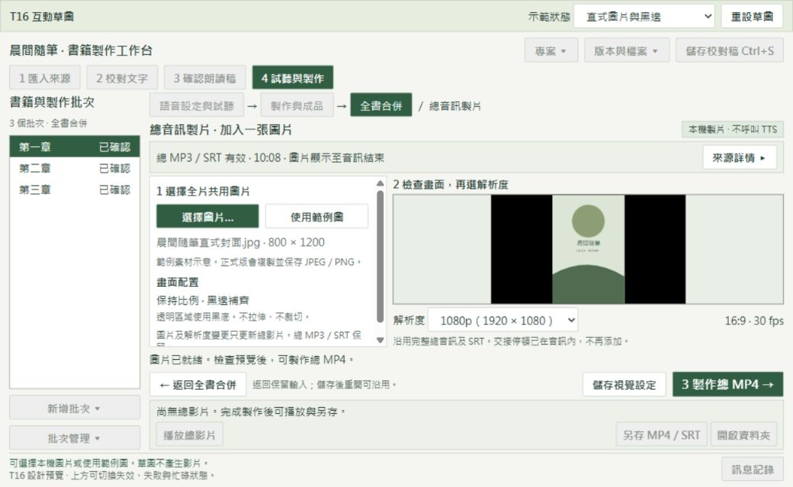

# T16：總音訊加圖片製作總 MP4

狀態：使用者已核准「做法一」兩步驟版本並授權實作。最終版面以 [v2 草圖](mock-ui/t16-two-step-v2/index.html) 為準；下列 v1 保留為設計歷程。正式驗收見 [T16 驗證](verification/T16.md)。

依據：`implementation-status.md` 最新 T15 交接、本機票稿 `.scratch/pdf-txt-audiobook-video/v1.1/issues/16-total-audio-image-to-video.md`、目前 `ebook2mp4/assembly_desktop.py` 與 T15 草圖。T16 是本機票號，不推定為遠端 issue #16。

[開啟互動 HTML](mock-ui/t16-total-video-v1/index.html)。可直接用瀏覽器開啟，不需安裝依賴。使用範例資料，不讀取書籍、不呼叫 TTS、不輸出影片。可手動選本機 JPEG／PNG，只在頁面內解碼預覽，不上傳。HTML 的內建範例是 SVG 示意，正式版須保存及驗證真正 JPEG／PNG。

## 操作順序與版面

保留目前中文字體、淺色背景、綠色主操作、四步驟導航、左側書籍批次與底部訊息。

1. 開啟「試聽與製作 → 全書合併」。在有效總音訊成品操作列按「製作 MP4」。這是預設總影片路徑，不要求批次 MP4。
2. 在同一主視窗開啟「總音訊製片」。上方一列顯示總 MP3／SRT 狀態及長度。版本與編碼資訊按「來源詳情」查看，不常駐占用版面。
3. 左側選一張全片共用圖片。顯示檔名及尺寸；正式版複製至專案。右側預覽完整 16:9 畫面。保持圖片比例，黑邊補齊，透明區黑底，不裁切、不拉伸。
4. 在預覽下方選 1080p 或 720p。預設 1080p，固定 16:9、30 fps。這是有限的輸出規格，不開放手填其他解析度。
5. 按右下方「3 製作總 MP4」。另有「儲存視覺設定」，可先保存而不製作。返回在左側，返回後保留輸入。
6. 底部顯示成品摘要與「播放總影片」「另存 MP4／SRT」「開啟資料夾」。播放上一版時明確標示。沿用總 SRT，與 MP4 一起另存；此草圖不新增字幕燒錄選項。

現有全書頁已接近最小視窗可用高度，再加入圖片預覽會壓縮原清單與固定操作。因此使用同主視窗內頁，並以兩欄配置選圖及預覽。左側素材區、詳情頁各自捲動；沒有外層整頁捲動。製作操作保持可見。預覽容器限制實際畫面為 16:9，避免因高度不足而改變預覽比例。

原有批次清單、停頓與接點檢查保持目前流程；草圖中這些既有操作多為停用示意，不代表產品移除功能。「使用範例圖」及上方狀態選單只供草圖測試，正式版不新增這些入口。

## 狀態及保護

沒有圖片時阻止製片。來源失效或尚無總音訊時，顯示原因及「前往更新總音訊」；不以舊來源冒充目前版本。更換圖片或解析度只使總影片待更新，不使總 MP3／SRT 失效。

進度及取消只在製片時出現。任務固定開始時的總音訊、字幕、圖片及解析度快照。停用衝突的編輯與製作操作。切換內頁保留任務，離開影片頁停止播放。取消先顯示釋放中，完成釋放後才可重試。失敗顯示原因，提供明確重試。驗證新成品後才發布，失敗或取消均保留舊影片與總音訊。

總 MP3 內已包含交接停頓，製片不再次加入靜音、不重算字幕偏移、不新增 TTS 請求。離線重開後仍可使用有效音訊及已保存圖片製片。正式版需 H.264／yuv420p、AAC-LC／48 kHz／立體聲、faststart；時長及字幕在真實工具驗證後才視為完成。

## 草圖驗證

2026-11-01 使用實際瀏覽器檢查 1040×640、1360×800。文件尺寸等於視窗尺寸。1040×640 的九種示範狀態中，可見按鈕與選單均未超出視窗，見 [版面檢查](mock-ui/t16-total-video-v1/layout-checks.json)。

已操作範例圖、直式黑邊、透明圖黑底、720p 保存及重載、失效來源阻擋、返回更新來源並保留圖片、取消釋放中與已取消、失敗重試。保存 [全書入口](mock-ui/t16-total-video-v1/preview-entry-1040.jpg)、[音訊失效](mock-ui/t16-total-video-v1/preview-invalid.jpg)、[較大視窗與待更新](mock-ui/t16-total-video-v1/preview-1360.jpg)。

HTML 只將範例圖片及解析度保存在瀏覽器；手選原圖只供當次預覽。正式版才會將選定原圖複製到專案，並保存音訊版本及視覺設定。草圖的進度、播放、重試、另存及資料夾操作均為模擬。原生 Tk、真實編碼、時間軸、跨程序鎖、離線製片及磁碟保護尚未驗收。

## 實作後驗收路徑（預定）

以下使用 ASD-STE100 風格中文：短句、單一動作、可觀察結果。不宣稱符合英文受控詞彙標準，也不是已通過的產品測試。實作後須補上每條結果及證據。

| ID | 操作路徑 | 確認結果 |
| --- | --- | --- |
| 1 | 開啟沒有批次 MP4 的測試專案 → 製作總 MP3／SRT → 按「製作 MP4」 | 開啟同主視窗製片頁。不要求批次影片。 |
| 2 | 按「選擇圖片」→ 選直式 JPEG → 檢查預覽 | 圖片完整。比例正確。兩側使用黑邊。顯示檔名與尺寸。 |
| 3 | 改選透明 PNG → 檢查預覽 → 選擇損壞圖片 | 透明區為黑底。損壞圖片被拒絕。原有效圖片保留。 |
| 4 | 選 720p → 按「儲存視覺設定」→ 返回 → 重開專案 → 移動原圖 | 圖片副本與 720p 設定保留。總音訊版本可查。 |
| 5 | 關閉網路 → 重開有效專案 → 按「製作總 MP4」 | 製片成功。不呼叫 TTS。不要求重新建立批次影片。 |
| 6 | 使用含交接停頓的總音訊 → 製片 → 解碼影片並比對總音訊與字幕 | 沒有重複交接停頓。字幕不再位移。影片時長差不超過 200 ms。 |
| 7 | 分別以 1080p、720p 製片 → 使用 FFprobe 及完整解碼檢查 | H.264、yuv420p、16:9、30 fps。AAC-LC、48 kHz、立體聲。具有 faststart。 |
| 8 | 製片完成 → 檢查隨附 SRT | 字幕非負、依序、不重疊。結尾不超出影片 200 ms。 |
| 9 | 完成總影片 → 更換圖片或解析度 → 檢查成品摘要 → 播放上一版 | 總影片待更新。舊版仍可播放。總 MP3／SRT 雜湊不變。 |
| 10 | 變更已選音訊來源 → 開製片頁 → 嘗試製片 → 前往更新總音訊 | 顯示來源失效原因。不能製片。更新後保留圖片與解析度。 |
| 11 | 開始製片 → 檢查控制項 → 切換內頁 → 返回 → 按「取消任務」 | 衝突操作停用。使用固定快照。取消後舊成品完整。程序已退出。 |
| 12 | 模擬磁碟不足或工具失敗 → 開始製片 → 檢查錯誤 → 排除原因 → 按「重試製片」 | 顯示具體原因。失敗不破壞舊影片或總音訊。重試成功後才發布。 |
| 13 | 製片完成 → 按「播放總影片」→ 停止 → 另存 MP4／SRT → 開啟資料夾 | 播放可停止。兩個另存檔案可讀。資料夾對應正確版本。 |
| 14 | 在同專案啟動另一產出任務 → 嘗試製片 → 取消並關閉程式 | 同時只有一個產出任務。沒有本次殘留程序、鎖或檔案占用。 |
| 15 | 啟動程式 → 還原至 1040×640 → 操作底部按鈕 → 調至 1360×800 | 啟動最大化。必要控制項可見。沒有重疊、裁切或水平捲動。 |

## 下一步與清理

本段記錄草圖階段的清理範圍。後續使用者已核准 v2 並完成實作；正式成品及清理明細以 T16 驗證文件為準。核准草圖、設計歷程與最終證據保留，使用者資料及正式 voice-blocks 不清除。
