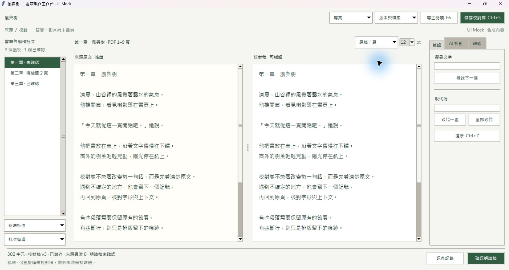
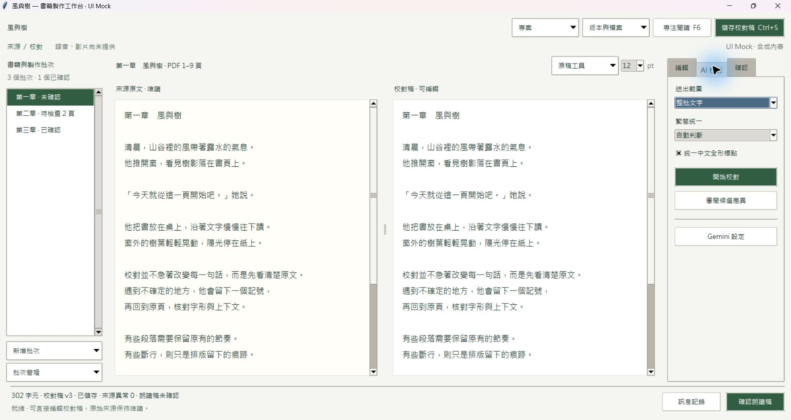
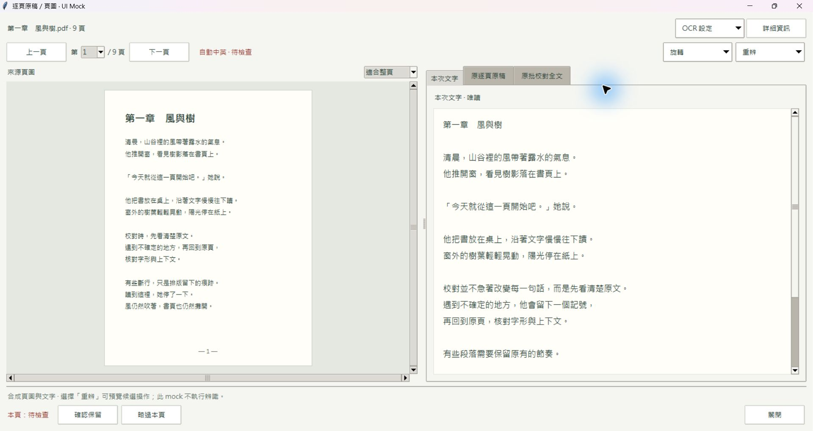
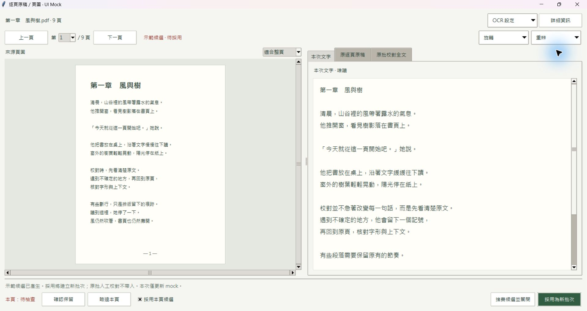
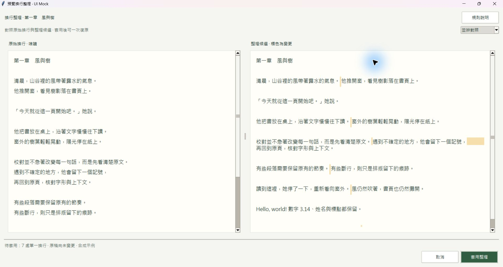

# 原生 Tkinter UI Mock

2026-10-26。保留的原始設計 mock。正式 UI 已依後續核定實作，並將朗讀確認移到確認分頁、儲存改為一般全域按鈕；最新實際畫面與新版程式見 `../verification/ui-layout.md`。此處截圖保留當時的 mock。

## 開啟

雙擊專案根目錄的 `ui_mock.pyw`。或在專案根目錄執行：

```powershell
python -B -m ebook2mp4.ui_mock
```

使用目前專案的 Python／Tkinter 即可。主畫面從「原稿工具」開啟逐頁頁圖或換行預覽；右側 AI 頁籤可開候選審閱。

直接開特定畫面：

```powershell
python -B -m ebook2mp4.ui_mock --screen pdf
python -B -m ebook2mp4.ui_mock --screen breaks
python -B -m ebook2mp4.ui_mock --screen ai
python -B -m ebook2mp4.ui_mock --screen review
python -B -m ebook2mp4.ui_mock --narrow
```

## 畫面

以下為程式實際執行後的原生視窗擷取；沒有以 HTML 或繪圖軟體重畫介面。

主工作台：



AI 工具頁籤，整組操作不需捲動：



逐頁原稿／頁圖，預設最大化與適合整頁：



有候選時才顯示候選勾選與採用動作：



換行整理，原文／候選並排與固定底部提交：



[1040×640 主窗第一輪檢查](images/workbench-narrow.png) · [補充：候選審閱](images/candidate-review.png)

## 可操作的部分

- 主窗三個工具頁籤、原生下拉選單、文字編輯、搜尋取代、復原、字級與 F6 專注閱讀。
- 模擬保存、朗讀確認及訊息記錄，狀態只在記憶體。
- 頁圖換頁、適合整頁／適合寬度／比例切換、框選示範、OCR 設定表單及候選階段切換。
- 換行整理比較、差異標色、候選單欄／並排切換、套用到合成稿。
- Gemini 候選切段、下一待確認、採用／拒絕決定及計數。

## 與正式實作的關係

| 畫面機制 | 實際使用的現有技術 |
|---|---|
| 字型、配色與基本按鈕 | 同一 Microsoft JhengHei、clam theme 與現有顏色／樣式 |
| 文字原稿及編輯區 | 直接重用正式 `desktop.text_pane`，原生 Text／Scrollbar |
| 可調雙欄 | 現有 ttk.Panedwindow |
| 工具分頁與三種原文 | 現有 ttk.Notebook |
| 具名下拉工具 | 標準 ttk.Menubutton 與 tk.Menu |
| 固定狀態與動作列 | Tk grid 容器，主內容列伸展，底部列固定 |
| 可最大化／還原文件窗 | 原生 Toplevel，保留 Windows 視窗按鈕 |
| 候選差異標色 | 現有 Text tag 與 difflib |

因此正式版本可沿用這些容器、元件與數值做出近似版面；後續仍須接回現有保存、OCR、Gemini、版本與取消邏輯。正式資料較長、視窗大小、字型或 Windows 縮放不同時，換行與可視行數會不同。

PDF 頁圖是用 Canvas 產生的合成示例；縮放展示閱讀配置。旋轉選單只示範重辨設定，不旋轉合成頁圖。正式 PDF 需接回 renderer，並驗證旋轉／縮放／框選座標轉換。批次清單為三個示範狀態，共用一份合成正文；匯入、匯出與重載等選單只展示入口。

不執行真實 OCR、不下載模型、不讀寫 API Key、不連線 Gemini、不開啟或更改正式書籍專案。即使按下模擬保存或採用，也不寫入書稿檔案。

## 驗證與收尾

- Python AST 語法檢查通過；實際啟動 native Tkinter。
- 第一輪檢查主窗最大化／1040×640、AI 工具、來源下拉、PDF 與換行預覽。
- 一次修正：文件工作窗調整為標準 Toplevel，修復最大化後缺少還原按鈕的問題；保留 checkbox 變數；初始訊息改為就緒摘要。
- 第二輪確認主窗、AI、PDF 正常／候選、換行比較；補充候選視窗檢視與下一待確認操作。
- 已實際檢查下拉選單、PDF 模擬候選產生、換行候選套用到記憶體。所檢視畫面未見明顯控制裁切或文字重疊；正文、清單正常使用捲軸，工具區無長捲動。
- 本次為 native mock，未使用瀏覽器驗證，未重跑正式功能測試。其他 DPI、輔助工具、最小 PDF／Gemini 視窗仍需在正式實作時驗證。
- 啟動使用 `-B`，不產生 bytecode；QA 程序於交付前關閉。保留 launcher、mock 來源、此說明及截圖成品。
