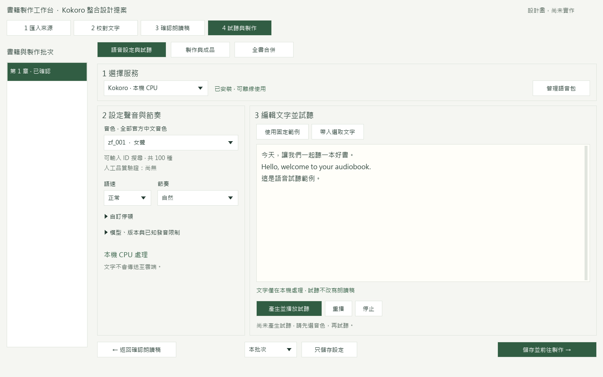
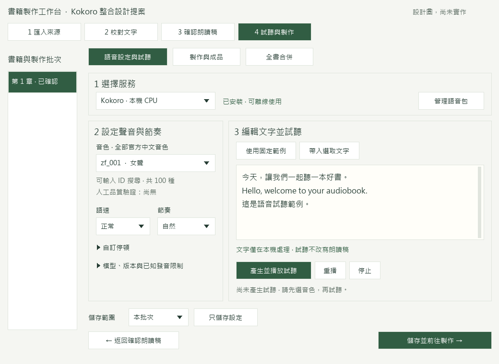

# Kokoro 整合操作設計 v1

2026-11-04。對應 [父規格 #2](https://github.com/newesp/ebook2mp4/issues/2) 與 [設計票 #5](https://github.com/newesp/ebook2mp4/issues/5)。使用者已同意繼續整合。本文件與圖片為設計提案，**尚未核准版面，尚未修改正式 UI**。

## 設計圖

| 內頁 | 最大化示意 1440 × 900 | 還原示意 1040 × 760 |
|---|---|---|
| 選服務、聲音與試聽 | [檢視](voice-wide.png) | [檢視](voice-restored.png) |
| 語音包管理與內頁移除確認 | [檢視](package-wide.png) | [檢視](package-restored.png) |
| 正式製作與成品 | [檢視](production-wide.png) | [檢視](production-restored.png) |

[完整狀態圖](states.png) 涵蓋未安裝、檢查／安裝中、安裝成功、缺少／損毀／不相容、載入中、合成中、完成、失敗、取消中與已取消。

## 核心操作

1. 進入「4 試聽與製作」→「語音設定與試聽」。
2. 選擇「Kokoro · 本機 CPU」。未安裝時顯示恢復入口，保留專案引用的模型及音色，不替換。
3. 按「管理語音包」，在同一主視窗內選擇已下載的包，按「檢查並匯入」。檔案選擇使用原生系統選檔器；其餘流程不開連續新視窗。
4. 檢查完整性、版本及 Windows／runtime 相容性。檢查通過後才啟用；取消或失敗清除未完成安裝。
5. 按「返回語音設定」。從全部官方中文音色選單選聲，可輸入正式 ID 搜尋，選單只接受包內有效音色。沒有預選音色，不默默換聲。
6. 選語速與節奏。「自訂停頓」只在需要時展開句尾與段落值，沿用既有合法範圍及預設值。
7. 按「使用固定範例」或「帶入選取文字」。試聽框可編輯，稿件原文不變；替換尚未試聽的編輯文字前，提供保留／取代／取消。
8. 按「產生並播放試聽」。載入與合成有狀態及取消；有結果後可「重播」與「停止」。取消僅在工作進行時出現。
9. 選擇「本批次」或「全書預設」，按「只儲存設定」。本批次的主要下一步為「儲存並前往製作」。全書預設的主要操作改為既有「套用到既有批次」，明確選批次後才套用，不自動回寫。
10. 正式製作頁讀取已確認朗讀稿。檢查後按「開始製作」，全部必要區塊完成及驗證成功後發布 MP3／SRT。完成後可進入既有全書合併與影片流程。

圖中 `zf_001`、批次名稱、任務區塊數及包體狀態均是示例，不代表開啟 UI 時已自動選定，也不代表正式整合已完成。

## 音色與文字

- 提供固定模型的全部 **100 種中文音色**。男女聲都在同一選單，不限制為兩種測試音色。
- 可以依 ID 搜尋；選單項目含 ID、性別及人工驗證標記。只有人工品質驗收通過的項目可標示「已驗證」。目前為 0，不把 CPU 技術測試當作聽感驗收。
- 本機顯示「文字僅在本機處理」。不顯示 API Key、雲端設定檔或雲端傳送同意欄；亦不自動改用雲端。
- 切回雲端服務後恢復該服務欄位；傳送同意預設勾選，取消勾選必須阻止送出。不得以切換服務恢復已取消的同意。
- 正規化只作用於合成副本，原稿、確認稿與字幕用原文保留。模型／版本、已知數字與多音字限制按需展開。
- 模型缺少、損毀或被移除時，選值保留並明示修復方式，不代選其他音色或服務。

## 狀態、忙碌與移除

| 狀態 | 呈現與可用操作 |
|---|---|
| 未安裝 | 顯示所需語音包；停用試聽與製作；可匯入。 |
| 檢查／安裝中 | 顯示目前階段與可量測進度；停用重複匯入、切服務及移除；可取消。 |
| 安裝成功 | 顯示已就緒及中文音色總數；可返回設定。 |
| 缺少／損毀／不相容 | 分列缺檔、SHA 校驗或相容性原因；不啟用半成品；可重新匯入。 |
| 載入中 | 不顯示虛構百分比或剩餘秒數；提示首次可能較久；可取消。 |
| 合成中 | 顯示區塊序號／總數；停用服務、音色、語速、停頓及重複開始；可取消。 |
| 完成 | 顯示完成、音長及重播；設定變更不冒充舊錄音為新錄音。 |
| 失敗 | 顯示分類及可執行恢復操作；保存前次成品與有效區塊；不自動雲端備援。 |
| 取消中 | 繼續鎖定衝突操作，直到推論程序確實退出。 |
| 已取消 | 顯示已停止，可返回設定或續作；保存完整有效區塊。 |

語音包移除確認在管理內頁展開，預設不刪除，使用紅色「確認移除」。取消只收合確認列。使用中的包不可移除；閒置載入中的模型須先結束 worker，確認釋放後才移除。書稿、有效音訊快取與正式成品保留。圖中的移除確認是展開狀態示例，平常不常駐。

## 狀態保留與小視窗

- 語音設定、試聽及包管理使用現有 `ProductionWorkspace` 的內頁切換。返回時保留範圍、音色、語速、停頓、試聽編輯文字、選取範圍與可重播結果。
- 批次切換各自保留未保存輸入；切換儲存範圍或服務時保留各自的暫存選值，不把前一服務音色套到另一服務。離開專案遇未保存設定時，提供保存／捨棄／取消。
- 儲存並重開後還原明確保存的模型、音色及語速。不保存雲端秘密於專案。
- 啟動維持最大化。1040 × 760 示意保留較窄批次欄，內容兩欄，試聽文字取得較大寬度；底部操作列改為兩列，返回在左、主要下一步在右。
- 文字框、音色下拉清單與任務表各自捲動；不使用整頁捲動再包內部捲動。沒有水平捲軸。較低視窗優先降低文字／表格區高度；必要操作列固定。
- 超過示意的 DPI／極小視窗仍須在正式 UI 完成後實測，本次圖片不是 live layout 驗收。

## 資源政策提案

K01 量測第一輪冷載入約 63 秒、同稿暖試聽約 6.9 秒、長稿 177 秒、峰值約 1.88 GiB。由此提出下列**產品預設候選值**，不是已實測保證：

- 載入限時 180 秒；獨立於單塊合成限時 180 秒。不得直接套用雲端 90 秒政策。
- 連續試聽及同次製作重用模型；最後一個工作完成後，閒置 120 秒卸載。合成、載入及正式製作區塊之間都不能觸發閒置卸載。
- 工作失敗、取消及關閉有明確終止路徑；取消後先等待退出，再顯示資源已釋放。K01 的 5 秒是加速測試設定，不是產品預設。
- 設定整合後，須以長稿與較慢電腦驗證候選限時；未測得可靠 ETA 前，只顯示階段與區塊進度。
- 分塊須檢查官方 510 音素上限，不靜默裁文。正式前處理政策及版本標識須隨合成副本及快取身分保存；不擅自修正已確認書稿。

## 預定驗收（ASD-STE100 風格）

1. 按「管理語音包」→ 選擇完整包 → 按「檢查並匯入」→ 確認已就緒。
2. 匯入損毀包 → 檢查原因 → 確認該包未啟用。
3. 返回語音設定 → 開啟音色選單 → 確認有 100 種官方中文音色。
4. 輸入 `zm_010` → 選擇該音色 → 產生試聽 → 確認使用男聲。
5. 改選女聲 → 產生試聽 → 保存 → 重開專案 → 確認選值保留。
6. 編輯試聽文字 → 切到包管理 → 返回 → 確認編輯文字與設定仍在。
7. 載入或合成中按「取消」→ 等待已取消 → 確認 worker 已退出。
8. 還原視窗 → 檢查底部操作 → 確認返回與主要下一步未裁切。
9. 按「儲存並前往製作」→ 檢查已確認稿 → 按「開始製作」→ 確認完成後才發布 MP3／SRT。
10. 按「移除語音包」→ 按「取消移除」→ 確認包仍可用。
11. 再次移除並確認 → 檢查書稿與成品 → 確認它們仍在。

## 設計檢查與核准

視覺根因：現有服務列與固定底部列若直接加入包資訊、100 種音色清單及說明，小視窗容易擠壓主要操作。結構方案為保留同視窗內頁、用可搜尋下拉選單取代常駐音色表、詳情按需展開、小視窗底部兩列。

依現有原生介面的 `PRODUCT.md`、`DESIGN.md` 與語音精簡版圖製作。使用 Pillow 繪製可重現配置；人工檢視大／小尺寸、操作狀態與文字適配。未執行 live UI 或瀏覽器驗收，因本階段只提案，正式 UI 尚未實作。`impeccable` context 引擎不可用，已直接讀取專案上下文；沒有安裝引擎或改動設計系統。

核准狀態：**待使用者確認本版設計圖**。依專案 AGENTS.md 第 12 點，取得確認前不實作正式版面。這次只需確認操作配置與資源政策候選值，無須先決定偏好音色。
