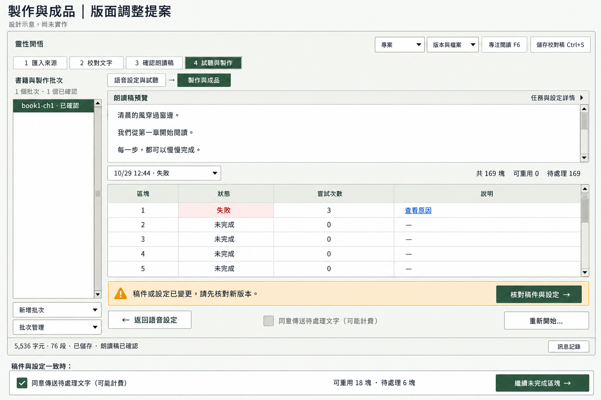

# 製作與成品：精簡版面提案

2026-10-30。僅提供設計圖；未修改產品程式，也未執行建置或測試。

主畫面呈現版本不一致時的狀態；圖下方另列版本一致時的操作範例，不是第二個視窗。

## 配置

- 原紅框：移除重複流程標題、書名／批次名及技術識別。主內容只保留一列「朗讀稿預覽」，右側提供「任務與設定詳情」。任務識別、朗讀稿識別、完整音色／語速／停頓及製作規則按需展開。
- 原藍框與綠框：改成橫跨內容寬度的兩列精簡操作區。第一列左側顯示需要處理的狀態，右側提供唯一主要操作；第二列由左至右放返回、傳送同意與重新開始。移除閒置進度條，取消按鈕只在執行時出現。
- 任務區：上方一列任務選擇與數量摘要，下方清單取得主要剩餘高度，能顯示至少五個完整區塊。清單與朗讀稿預覽各自捲動；圖示桌面尺寸下不需整頁捲動或水平捲動。
- 版本不一致時，主要操作顯示「核對稿件與設定」，不能直接續作。核對一致後才使用圖下方狀態範例中的「繼續未完成區塊」。

## 繪圖方式與提示

使用內建 imagegen；原截圖只作介面結構參考。保留既有原生 Windows／Tk 風格、綠色調、四步驟導航、左側書籍批次及單一主視窗。重新繪製主內容：一列標頭、精簡朗讀預覽、一列任務工具列、可擴展區塊清單、橫跨全寬的精簡操作列。呈現使用者截圖中的稿件／設定變更狀態，另外附一列可續作時的操作範例。文字使用繁體中文；範例數字及內文為設計示意。移除紅藍綠框註記、冗長固定說明、重複識別及大面積無用途留白，不加入新視窗。

設計圖不代表功能已實作；待使用者確認後才安排程式修改。
