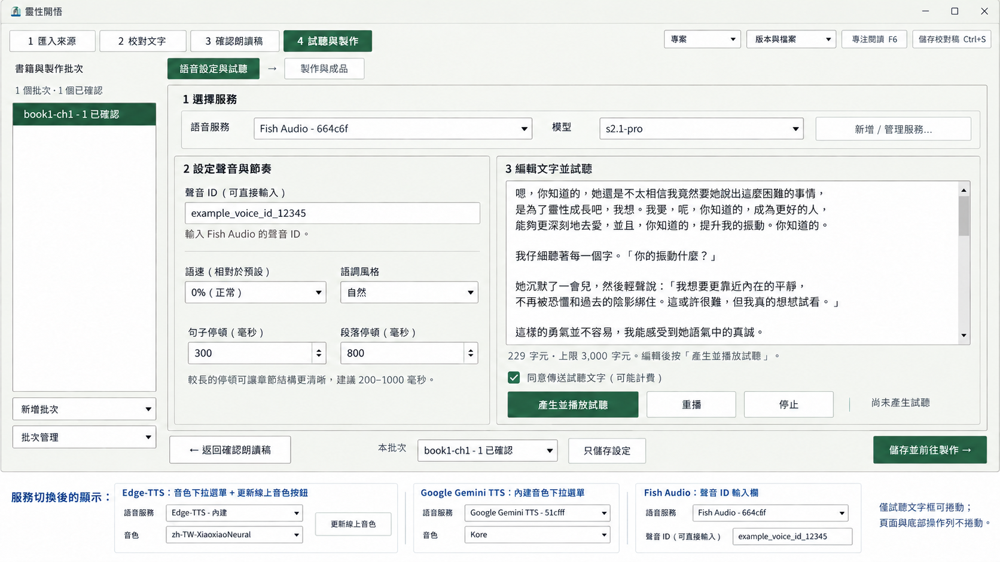

# 語音設定與試聽：精簡版面提案

2026-10-30。此階段只提供設計圖，尚未修改產品程式。

後續：使用者已核准實作。完成結果與逐步驗收見 [語音 UI 驗證](../../verification/voice-compact.md)；以下保留原核准提案。

## 配置

- 上方一列依序選擇服務、模型及管理服務。
- 中間左側設定聲音與節奏，右側編輯文字並試聽。移除常駐的大型音色表，依服務提供適用的選項。
- Edge-TTS 顯示音色選單與更新線上音色；Google Gemini TTS 顯示內建音色候選；Fish Audio 顯示聲音 ID 輸入欄。非 Edge 服務不顯示 Edge 更新按鈕。
- 句尾與段落停頓併為一列。試聽操作併為一列。傳送同意維持預設勾選。
- 底部一列由左至右放返回、儲存範圍／只儲存設定、儲存並前往製作。
- 目標桌面尺寸下，頁面不捲動。長文只在試聽文字框內捲動，不形成內外雙層捲動。

下方服務切換範例是設計註記，不是第二個視窗，也不是主畫面同時出現的控制項。圖中文字與資料僅供版面示意。

## 預定驗收路徑

以下使用短句、單一動作及可觀察結果，供確認設計後實作驗收。

1. 選擇「Edge-TTS」 → 檢查音色選單 → 檢查更新音色按鈕。
2. 選擇「Google Gemini TTS」 → 檢查內建音色候選 → 確認 Edge 更新按鈕未顯示。
3. 選擇「Fish Audio」 → 檢查聲音 ID 欄 → 確認 Edge 更新按鈕與空白音色表未顯示。
4. 開啟語音設定頁 → 檢查所有主要欄位及底部按鈕 → 確認不需捲動頁面。
5. 在試聽框貼入長文 → 捲動文字 → 確認只有文字框捲動，底部按鈕保持可見。
6. 檢查底部操作列 → 確認返回、儲存範圍、只儲存設定及前往製作位於同一列。

## 繪圖方式

使用內建 imagegen，參考使用者提供的兩張截圖。提示重點為：保留原生 Windows 外觀、繁體中文、綠色主按鈕及單一工作視窗；服務與模型收為上方一列；聲音設定與試聽分為左右兩欄；依供應商顯示適用音色控制；底部改為單列；整頁不顯示捲軸，只有長文試聽框可捲動。生成結果保留為正式設計圖，無測試程序或建置暫存。
