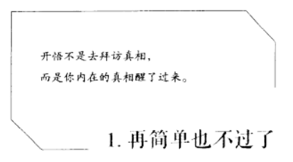

# 混合字型與標題被誤辨為英文的 OCR 案例（待評估）

2026-10-26，使用者要求「先記著，評估但別實作」。本次僅查看附圖、現有 OCR 設定與官方資料，沒有修改程式、安裝依賴、重跑 OCR 或上傳圖片給外部 AI。下列優化是候選方案，未核定、未排入既有票稿，也沒有宣稱實測改善率。

## 使用者案例

使用者提供的預期文字（繁體表達）：

> 開悟不是去拜訪真相，而是你內在的真相醒了過來。1. 再簡單也不過了

使用者回報的 OCR：

> 開悟不是去拜訪真相,而是你內在的真相醒了過來。1. FR Pu Al

主要問題是「再簡單也不過了」被辨識成拉丁字母，另有中文逗號誤用半形。附圖實際標題可見「再简单也不过了」等簡體字形；辨識是否忠實原字體，應與後續是否轉成繁體分開驗收。前一項 [繁簡／標點統一提案](proofreading-normalization-proposal.md) 不能單獨復原已誤辨成英文的中文字。

## 觀察與初步假設

- 附圖只有 412×228 像素，包含較小的兩行引文、較大的標題、大片留白及裝飾框線；字型與筆畫呈現也不同。這是對附圖的觀察，不能據此斷定原 PDF 或實際送進 OCR 的頁圖同樣低解析度。
- 現行 `ebook2mp4/ocr.py` 使用 Tesseract LSTM、`--psm 6`（單一均勻文字區塊）、`--dpi 300`，並依選擇載入繁中／簡中＋英文或英文。`ebook2mp4/pdf.py` 記錄 300 DPI 與 25M pixels 上限。此布局可能不符合單一均勻區塊的假設，值得比較其他切區方式；尚不能確診這就是本例失敗的唯一原因。
- 圖中文字有簡體字形，應確認本例實際選用的語言模型。使用何種模式、模型、原 PDF 頁圖及擷取範圍目前未完整提供，不假定使用者選錯。
- 人眼可讀不表示目前 OCR 模型必然可讀；字型、筆畫斷裂、框線、頁面切分、語言模型等都可能影響結果。單純把圖片放大或指定 300 DPI 不會補回缺失的原始筆畫。

## 建議優先評估

1. **分區辨識引文與標題。** 避開裝飾框線，保留適當白邊，將標題裁成獨立單行，對照現行整頁 `psm 6`、自動版面與單行 `psm 7`；分區後依位置重建閱讀順序，不因裁切漏掉引文、編號或正文。
2. **比對語言模型。** 以原圖字形選擇簡中／繁中模型，評估中文優先或區域別語言策略。不能為避免英文誤辨而在全頁禁用英文字母，否則會破壞真實英文內容。
3. **比較原 PDF 高解析度渲染及有限前處理。** 對照原圖、對比／二值化、框線排除等候選；避免處理掉細筆畫或把字黏在一起。不能把低解析截圖的插值放大當成新增真實細節。
4. **標記可疑中英混淆並允許局部重試。** 中文頁中短標題突然出現 `FR Pu Al` 可列待檢查；但英文引句、縮寫或專有名詞本來可能正確，不可直接刪除或自動硬改。可評估取得 OCR 信心度與文字座標輔助判斷，但分數不能當正確率保證。
5. **需要看圖的備援另外評估。** 現行 Gemini 校對只取得所選文字，不會看到原頁圖；僅憑 `FR Pu Al` 無法可靠還原原標題，不應讓 AI 猜出通順句子就當辨識成功。若未來增加圖片辨識備援，應獨立設計明確的圖片送出操作與範圍提示，不自動上傳原 PDF 或全書素材。

## 後續驗證建議（尚未執行）

- 以使用者原 PDF 對應頁為主要驗證來源，附圖為補充；記錄實際模式、模型、渲染尺寸及辨識區域。
- 分開比較引文、編號、標題的識字結果與閱讀順序，包含「再简单也不过了」是否完整保留，不能只驗證輸出含有一些中文字。
- 另放真正英文標題、混合中英文、小字引文及其他字型頁作對照，避免只對這張圖調到成功。
- 將忠實原文辨識、繁簡轉換與中文標點統一分開記錄；採用候選前保留原擷取／人工校對版本，支援拒絕與撤回。

參考：[Tesseract 官方辨識品質指引](https://tesseract-ocr.github.io/tessdoc/ImproveQuality.html)，涵蓋解析度、二值化、筆畫、邊框、傾斜與頁面切分。官方列 `psm 6` 為單一均勻文字區塊、`psm 7` 為單行；以上針對本例的原因假設與方案優先順序是本專案推論，尚非實測結論。
