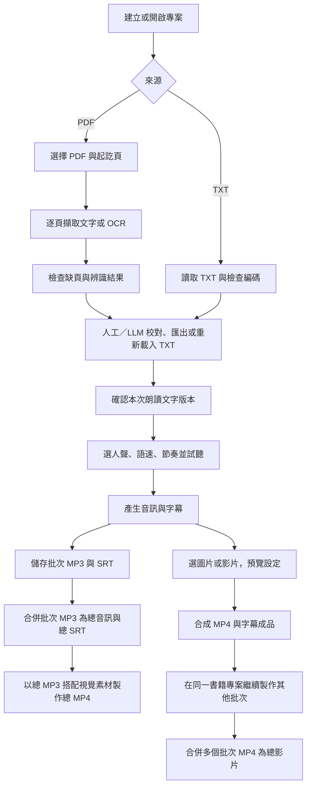

# 中英文 PDF／TXT 朗讀影片工具需求規格

- 文件版本：v0.7
- 日期：2026-10-25
- 狀態：使用者已確認首版與增補需求，作為開發與驗收基準；對應正式 Spec v1.1。
- 產品定位：將 PDF 或 TXT 整理成可校對的文字，再產生自然朗讀音訊，並選擇搭配圖片或影片輸出 MP4。
- 開發方向：建立精簡的新工具；參考 `E:\Leo\Projects\novel-generator` 的 Edge-TTS 與 FFmpeg 流程。

## 1. 目標與基本原則

### 1.1 使用者目標

1. 讀取中文或英文 PDF，支援文字型、掃描型及文字／圖片混合頁面。
2. 選擇 PDF 要處理的起訖頁，避免整本轉換。
3. 取得 TXT，在工具內或外部編輯器校對，保存可重複使用的校對稿。
4. 第一版提供人工校對與可選用的 LLM 輔助校對 TXT，修改內容由使用者確認。
5. 從明確確認的校對稿產生可選人聲、語速與閱讀節奏的音訊。
6. 視需要加入圖片或背景影片，合成可供手動上傳 YouTube 的 MP4。
7. 可以直接從 TXT 開始，略過全部 PDF 與 OCR 步驟。
8. 可以分次完成工作，關閉工具後重新開啟專案繼續。
9. 一本書建立一個專案；可按頁碼範圍分批製作，以不同檔案保存批次成品，最後將多個批次 MP4 合併為一個總 MP4。
10. 同一書籍專案可直接將有效批次 MP3 合併成總音訊及總 SRT，不依賴 MP4；與總影片共用批次、順序及交接停頓，視覺變更不影響有效音訊。

### 1.2 第一版基準

以下為已討論的首版基準；具體框架與實作工具留待技術設計，需符合這些使用行為：

| 項目 | 第一版基準 |
| --- | --- |
| 使用環境 | Windows 本機、單人操作 |
| 介面語言 | 繁體中文；輸入內容可為繁體中文、簡體中文或英文 |
| 介面形式 | 可安裝的 Windows 桌面圖形程式；日常操作不需終端機或自行啟動本機網頁伺服器，具體框架待設計 |
| 介面方向 | 採 A 版校對工作台：左側書籍／批次、中間原頁／校對稿、右側校對與確認工具 |
| 資料保存 | 專案檔、校對稿與成品保存在本機 |
| OCR | 本機執行；引擎隨安裝包提供，中文及英文模型首次使用時顯示下載大小並由工具安裝 |
| 校對 | 人工編輯與工具內 LLM 設定／輔助校對均為首版功能；LLM 首版僅支援 Gemini，使用者可只採人工校對 |
| 專案與批次 | 一本書一個專案，容納不同頁碼範圍的製作批次；首版支援總 MP3／SRT 及總 MP4／SRT，兩格式共用全書合併設定 |
| TTS | Edge-TTS，需要網路；合成文字會送至線上服務 |
| 影片 | 本機 FFmpeg／FFprobe；第一版每個製作批次選一張圖片或一支背景影片，批次成品可再合併 |
| 首版完整流程 | PDF 讀取 → 文字擷取／OCR 轉 TXT → 人工／Gemini 校對 → 確認朗讀稿 → 批次 MP3／SRT → 總 MP3／SRT → 加入全片視覺素材 → 總 MP4；TXT 直接進入校對，亦保留批次 MP4 及其合併路徑 |
| 輸出選擇 | 首版須具備 MP4 合成功能；使用者仍可只輸出 MP3／SRT，不要求提供視覺素材 |

### 1.3 不可違反的原則

- 不覆寫輸入 PDF、輸入 TXT、圖片或影片。
- 不在使用者未確認時自動改寫、翻譯、摘要、刪減書籍內容，或轉換繁簡體。
- 音訊必須來自已確認的文字版本；任何朗讀前處理都應能查看，不得藏有內容變更。
- 單頁擷取或單段合成失敗，不得悄悄略過並宣告完整成功。
- 不要求安裝或載入 GPU 語音模型；PDF／TXT 校對不依賴 TTS 或影片工具可用。
- 不因更換圖片、影片或輸出解析度而重新合成未變更的朗讀音訊。

## 2. 使用流程

首版即提供 PDF／TXT 雙入口、PDF 文字擷取與 OCR、人工／LLM 校對，以及直到 MP4 的完整流程。

### 2.1 PDF 入口

選 PDF → 確認總頁數與起訖頁 → 選 OCR 語言／模式 → 擷取 → 檢查異常頁 → 校對 → 儲存 TXT → 確認朗讀版本。

### 2.2 TXT 入口

選 TXT → 檢查編碼與內容 → 視需要校對 → 儲存校對稿 → 確認朗讀版本。此流程不得要求 PDF、頁碼、OCR 引擎或 OCR 模型。

兩種入口均使用相同的人工／LLM 校對功能；確認朗讀版本後，接續 TTS → MP3／SRT → 選圖片或背景影片 → MP4。

### 2.3 外部校對與續作

匯出 TXT → 在外部編輯器修改 → 回到專案重新載入 → 確認變更 → 重新確認朗讀版本。若工具內有尚未儲存的編輯，需讓使用者選擇保留副本或取代，不得直接丟失。

### 2.4 一本書分批製作與合併

- 一本書對應一個專案，不要求每次選新頁碼都建立另一個專案。
- 例如先製作第 21～50 頁，再製作第 51～80 頁；不同製作批次以不同檔案保存 TXT 與音訊／字幕／影片成果，不覆蓋其他批次的檔案。
- 首版可將同一專案的多個批次 MP4 合併為一個總 MP4。
- 每個批次有獨立的 TXT 校對稿、校對進度與朗讀確認；修改一批不取消另一批的朗讀確認。專案集中列出各批次檔案與狀態。
- 合併時由使用者選取批次與順序，PDF 批次預設依起始頁排序，可手動調整；PDF 頁碼重疊或缺口只提示，由使用者決定是否繼續，不自動刪除或補入內容。
- 每份匯入 TXT 成為一個批次，PDF 專案也可加入同書的 TXT 批次；以名稱與手動排序區分，不假造 PDF 頁碼，首版不自動辨識章節或拆檔。
- 合併另產生總 SRT，時間包含實際批次長度與交接停頓。相鄰批次間預設額外補 0.5 秒靜音，介面可調為 0～5 秒並預覽接點；保留原音訊頭尾，實際間隔可能更長。新增停頓期間顯示前一批最後一格並清空字幕，最後一批後不補交接停頓。不插入片頭或轉場特效。
- 合併前顯示前批結尾與後批開頭，供使用者檢查是否切在半句；可返回校對調整，工具不自動跨批搬動或刪改文字。
- 總影片記錄選入的批次與版本；其中任一批改稿或更新 MP4，舊總影片保留可播但標為待更新。重新合併只選與目前內容一致的有效 MP4，未選批次的變更不影響它。
- 合併可選總影片解析度，將不同解析度批次統一尺寸並保持比例；音色／語速不同只提醒，不重配音。

### 2.5 總音訊與共用合併設定

- 直接以目前文字／語音設定一致的有效批次 MP3 合併總 MP3，另輸出總 SRT，不需圖片、背景影片或批次 MP4，不新增 TTS 請求。
- 總音訊與總影片共用批次選取、順序與交接停頓；同一「全書合併」畫面可選 MP3、MP4 或兩者。預設額外 0.5 秒、可調 0～5 秒，保留原頭尾，最後一批後不補交接靜音。
- 總音訊字幕依實際音訊及新增停頓偏移，新增停頓期間不維持前批字幕；各格式的字幕對應自己的成品時間軸，不能只因共用設定就忽略編碼造成的實際時長差異。
- 變更圖片、背景影片或影片解析度，總 MP3 保持有效；選入批次文字／語音設定、合併順序／停頓變更，相關總音訊標待更新，舊檔保留可播。未選批次修改不影響它。
- 同時選兩格式時依格式檢查各自必要輸入，可用者先完成；缺項／失敗者明列，整體顯示部分完成，不宣告全部成功。保留成功格式成果，補齊或重試只處理尚未完成格式，不回滾或重做已成功項目。

### 2.6 總音訊直接製作總影片

- 已完成且與當前內容／語音及合併設定一致的總 MP3，可直接作為總 MP4 的旁白來源，不必先建立任何批次 MP4。
- 沿用總 MP3 與總 SRT 的既有時間軸，不重新 TTS、不重排朗讀內容，也不再次補入已含在音訊中的交接停頓。
- 保留「合併既有批次 MP4」路徑；不同路徑檢查不同必要輸入。缺批次 MP4 只影響批次影片合併，不阻擋總音訊製片。
- 總音訊製片保存來源總 MP3／SRT 版本及視覺設定；總音訊失效或更新時，對應總影片待更新，純視覺修改不失效總 MP3。
- 預設影片方式為「總音訊製片」：總音訊成品可按「製作 MP4」，選一張圖片或一支背景影片供整片使用；也能切換「合併既有批次影片」以保留各批畫面。
- 總音訊製片沿用既定的比例補邊、解析度、編碼、長背景裁切、短背景循環／定格與原聲靜音規則，不增加多素材時間軸。

## 3. 功能需求：來源與 PDF 擷取

| 編號 | 需求 | 優先級 |
| --- | --- | --- |
| SRC-01 | 新專案提供「從 PDF 開始」與「從 TXT 開始」兩個同等入口 | P0 |
| SRC-02 | 顯示來源檔名、大小、可讀狀態與專案儲存位置 | P0 |
| PDF-01 | PDF 載入後顯示總頁數及起訖頁，預設整份文件 | P0 |
| PDF-02 | 使用 PDF 實際頁面順序，以 1 為第一頁，起訖頁均包含在範圍內 | P0 |
| PDF-03 | 起訖頁必須為整數且滿足 1 ≤ 起始頁 ≤ 結束頁 ≤ 總頁數；錯誤時禁止擷取 | P0 |
| PDF-04 | 提供選定頁面的預覽，並標明 PDF 頁次與書上印刷頁碼可能不同 | P0 |
| PDF-05 | 只處理選取範圍內的頁面，輸出順序與 PDF 一致 | P0 |
| PDF-06 | 保留每頁的原始頁次、擷取方式、狀態、原始擷取文字及錯誤訊息 | P0 |
| PDF-07 | 遇到損毀、無法讀取或受密碼保護的 PDF，說明原因並讓使用者更換檔案；首版不提供解密功能 | P0 |

### 3.1 文字型 PDF

- 優先讀取可用的文字層，支援繁體中文、簡體中文、英文及中英混合文字。
- 以清晰、橫排、單欄正文作為第一版品質驗收範圍。
- 提供保留原始換行與整理版面換行兩種方式，清理結果可預覽、撤回。
- 英文單字之間的空格、數字、小數點、縮寫與標點不得因清理而任意消失。
- 跨行連字號、頁首頁尾與頁碼清理不得默默套用；首版可由使用者在校對階段處理。

### 3.2 掃描型與混合型 PDF

| 編號 | 需求 | 優先級 |
| --- | --- | --- |
| OCR-01 | 提供繁體中文＋英文、簡體中文＋英文、英文三種 OCR 設定；不以 TTS 人聲決定 OCR 語言 | P0 |
| OCR-02 | 提供自動判斷與全部強制 OCR；自動模式須逐頁判斷，不能只看整份 PDF | P0 |
| OCR-03 | 無可用文字層的頁面，自動轉成圖片後辨識 | P0 |
| OCR-04 | 頁面只有少量文字、主要內容疑似為圖片時，標示為待檢查；不得只因存在頁碼就認定正文已擷取完成 | P0 |
| OCR-05 | 可對指定頁重新強制 OCR；重新辨識先產生候選結果，不直接覆蓋已校對文字 | P0 |
| OCR-06 | 提供 90°、180°、270° 手動旋轉後重新辨識 | P0 |
| OCR-07 | 明確區分辨識成功、辨識失敗、無文字／空白待確認，並支援只重試失敗頁 | P0 |
| OCR-08 | 顯示原始頁面與對應擷取文字，方便比對；空白頁或無字頁由使用者確認保留／略過 | P0 |
| OCR-09 | OCR 缺少執行檔或語言模型時，顯示缺項與安裝指引；不得阻擋直接 TXT 入口 | P0 |
| OCR-10 | 自動去歪斜、多欄順序處理、直排中文及複雜表格辨識 | P1 |

OCR 是待校對的轉錄結果，不保證逐字正確。首版不承諾手寫字、嚴重模糊、破損、直排或複雜版面的辨識品質。遇到此類文件，仍可讓使用者強制辨識並手動校對，不能將結果宣稱為可靠完成。

若採 Tesseract，需使用正確模型代碼，例如 `chi_tra`、`chi_sim`、`eng`；不以 `zho` 檔名代替模型語言設定。模型代碼依官方文件核對。[S2]

## 4. 功能需求：TXT 與文字校對

| 編號 | 需求 | 優先級 |
| --- | --- | --- |
| TXT-01 | 支援直接讀取 TXT，至少支援 UTF-8、UTF-8 BOM 與 UTF-16 BOM；提供 Big5／CP950 手動選擇及載入預覽 | P0 |
| TXT-02 | 解碼失敗或疑似亂碼時，提示更換編碼，不得用替代字元靜默吞掉原文 | P0 |
| TXT-03 | 工具內可編輯全文，支援搜尋、取代、復原及儲存 | P0 |
| TXT-04 | 可另存為 UTF-8 TXT，亦可重新載入外部校對後的 TXT | P0 |
| TXT-05 | PDF 擷取原稿與校對稿分開保存，可回看原稿 | P0 |
| TXT-06 | 以空白行表示段落；保留中英文標點，不自動做繁簡轉換或內容改寫 | P0 |
| TXT-07 | 顯示儲存狀態、目前版本、字元數與非空段落數 | P0 |
| TXT-08 | 提供「確認為本次朗讀稿」，將當下內容存為不可變的版本快照 | P0 |
| TXT-09 | 有未確認的異常頁時，列出清單；使用者處理或明確確認略過後，才可確認朗讀稿 | P0 |
| TXT-10 | 自動移除重複頁首頁尾、智慧修正斷行與英文跨行連字號 | P1 |
| TXT-11 | 同一專案每份匯入 TXT 各成為獨立批次，可與 PDF 批次並存；以名稱與手動排序管理，不假造頁碼，首版不自動分章拆檔 | P0 |
| LLM-01 | 首版提供可選用的 LLM 輔助校對，適用於 PDF 轉出的 TXT 與直接匯入的 TXT；未設定或不可用時仍可人工校對 | P0 |
| LLM-02 | LLM 結果先保存為候選稿，提供原文與修改差異供使用者確認後套用；不得直接覆寫校對稿或自動確認為朗讀稿 | P0 |
| LLM-03 | 使用雲端 LLM 前顯示服務／模型及將送出的文字範圍，由使用者主動啟動；失敗或取消時保留原稿，套用結果後取消既有朗讀確認狀態 | P0 |
| LLM-04 | 首版在工具內提供 Gemini 設定並直接呼叫 Gemini 校對；不要求使用者以外部網站複製貼上代替內建功能，其他 LLM 提供者留待後續 | P0 |
| LLM-05 | 可填入並儲存 Gemini API Key、選擇／調整模型及測試連線；金鑰留在本機設定，不寫入書籍專案 | P0 |
| LLM-06 | 可校對整份批次 TXT 或選取部分；逐段顯示差異，支援採用、拒絕與全部採用，採用後仍須另行確認朗讀稿 | P0 |
| LLM-07 | 長稿分段校對，保留已完成候選結果，標示失敗／未完成範圍並可只重試失敗部分；不將部分結果宣告全部完成、不自動套用 | P0 |

### 4.1 校對稿與頁碼的關係

- PDF 原始擷取結果保留逐頁對應，供校對時查閱。
- 匯出的朗讀 TXT 預設不插入「第 N 頁」標籤，避免被讀出聲。
- 頁碼資訊另存於專案資料，不混入朗讀正文。
- 外部 TXT 編輯可能改變段落，重新載入後不得假裝仍有精確的逐句頁碼對應；原始逐頁資料仍保留，精確對應失效時需清楚標示。
- 校對稿不得因切句、語音合成或字幕生成而被反向改寫。

### 4.2 LLM 輔助校對

- Gemini 僅修正轉錄／OCR 錯字、標點及明顯斷行問題，不潤飾文風、翻譯、摘要、刪減內容或轉換繁簡體；無法確定原文時保留疑點，交由使用者判斷。
- 保留校對前版本、候選結果與採用後版本，使用者可比較並撤回修改。
- LLM 首版僅使用 Gemini，採 API Key 與可調整的模型設定，提供儲存與連線測試；人工校對不依賴 Gemini 初始化或服務可用。
- 候選結果保存其來源校對稿版本與處理範圍；若等待結果時原稿已變更，須提示版本差異，不以舊候選直接覆蓋新編輯。

## 5. 功能需求：TTS 與閱讀品質

### 5.1 人聲與試聽

| 編號 | 需求 | 優先級 |
| --- | --- | --- |
| TTS-01 | 第一版以 Edge-TTS 為語音提供者，沿用 `novel-generator` 的呼叫思路；不要求本機 GPU | P0 |
| TTS-02 | 可選台灣華語、中國普通話、英文等可用音色；顯示語系、名稱及服務有提供的性別資訊 | P0 |
| TTS-03 | 執行時可更新可用音色清單，保留快取；不可將寫死的音色清單當成永久有效 | P0 |
| TTS-04 | 選定音色不可用時，提示改選；不得無聲切換成另一人聲 | P0 |
| TTS-05 | 可用固定範例或校對稿選取內容試聽，試聽使用與正式輸出相同的文字處理及節奏設定 | P0 |
| TTS-06 | 提供語速設定，第一版至少包含 -20%、-10%、正常、+10%、+20%；預設正常 | P0 |
| TTS-07 | 每次合成使用一個明確選定的人聲；中英混合文字不自行插入其他人聲 | P0 |
| TTS-08 | 中英文自動切換人聲、角色配音與逐段指定人聲 | P1 |
| TTS-09 | 專案提供全書語音預設，新批次沿用並可個別調整；變更全書預設不自動修改或重做舊批次，使用者可明確套用至指定批次後重新產生 | P0 |

台灣華語預設候選可參考 `zh-TW-HsiaoChenNeural`、`zh-TW-HsiaoYuNeural`、`zh-TW-YunJheNeural`，英文可參考 `en-US-JennyNeural`；實際是否可用以當下服務清單與試聽結果為準。

中英混合文字應完整保留；單一音色讀另一語言的口音與品質，以試聽驗收，不承諾自動達到雙語母語者水準。

### 5.2 斷句與停頓

1. 優先保留完整段落的上下文，再依引擎限制切成可合成的文字區塊。
2. 需要切分時，優先使用句號、問號、驚嘆號等語句結尾，再使用合理的分句位置；不得以固定 41 字或其他短字數一律硬切。
3. 避免切開英文單字、姓名、縮寫、小數、網址，以及中文語詞；引號、括號與省略號需納入切句驗證。
4. 切分不得造成漏字、重複或順序改變；必要的朗讀正規化須列出規則，且不修改校對稿。
5. 中文逗號、句號與英文標點應交由語音服務自然處理，不為了套用舊引擎規則而任意替換。
6. 工程上的切塊不等於句尾或段落，不得每個切塊都插入相同的長停頓。
7. 不任意裁掉音節尾音或引擎本來的呼吸停頓。

第一版提供以下「額外停頓」設定，數值指加在原有語音之外的靜音：

| 位置 | 預設額外停頓 | 可設定範圍 | 規則 |
| --- | ---: | ---: | --- |
| 一般句尾 | 0 毫秒 | 0～1,500 毫秒 | 預設保留引擎自然韻律；非零時需能依句尾產生對應的合成與時間資訊 |
| 空白行所分隔的段落 | 500 毫秒 | 0～3,000 毫秒 | 補在段落之間；最後一段不額外補尾部靜音 |

- 同一位置同時是句尾與段落結尾時，使用較長的一個設定，不重複相加。
- 「自然」預設為句尾 0／段落 500 毫秒；「舒緩」預設為句尾 200／段落 800 毫秒，均可自行調整。
- 非零句尾停頓可能需要改成逐句合成，應透過試聽比較是否破壞語調；不可宣稱單靠補靜音就能修正所有不自然的語音。
- 不依賴任意自訂 SSML 達成上述功能；Edge-TTS 的可用控制受服務限制。[S1]

### 5.3 合成、音訊與字幕

| 編號 | 需求 | 優先級 |
| --- | --- | --- |
| AUD-01 | 顯示目前段落／區塊、完成數與失敗狀態；可取消、重試及續作 | P0 |
| AUD-02 | 網路錯誤可有限次數重試，預設每區塊至多 3 次；仍失敗時保留進度並提示，不無限重試 | P0 |
| AUD-03 | 第一版匯出 MP3；提供成品播放、另存與開啟所在資料夾 | P0 |
| AUD-04 | 同步匯出 UTF-8 SRT；可使用提供者時間資訊，必要時以完整合成區塊作為字幕單位，不虛構逐字時間 | P0 |
| AUD-05 | 音訊檔非空、可解碼，所有必要區塊完成後才可標記合成成功 | P0 |
| AUD-06 | 校對稿局部修改後，只重新合成失效區塊及重建合併成品；保留其他可重用區塊 | P0 |
| AUD-07 | WAV、其他 TTS 提供者及本機離線引擎 | P1 |
| AUD-08 | 直接合併有效批次 MP3 為總 MP3，不要求批次 MP4、視覺素材或新增 TTS 請求 | P0 |
| AUD-09 | 總音訊與總影片共用全書合併設定，可選輸出 MP3、MP4 或兩者；交接預設額外 500 毫秒，介面可調整與預覽 | P0 |
| AUD-10 | 總 MP3 附總 SRT，依實際音訊與交接停頓計算時間，新增靜音區間不維持前批字幕 | P0 |
| AUD-11 | 總音訊追蹤選入音訊內容／語音設定與合併順序／停頓，視覺／解析度變更不失效；未選批次不影響，舊成果保留可播 | P0 |
| AUD-12 | 同時輸出多格式時按格式顯示完成／缺項／失敗，可用者先完成、成功成果保留，整體部分完成不冒充全部成功，重試只處理未完成格式 | P0 |

字幕時間必須反映實際語音長度、額外靜音及區塊偏移。設定段落停頓後，不得仍沿用未加停頓的舊時間；字幕應跟隨朗讀內容，額外段落靜音期間不持續顯示上一段字幕。

## 6. 功能需求：圖片／影片合成 MP4

### 6.1 共通需求

| 編號 | 需求 | 優先級 |
| --- | --- | --- |
| VID-01 | 從已完成且與當前文字／TTS 設定一致的音訊合成 MP4，不再重新呼叫 TTS | P0 |
| VID-02 | 每個製作批次選擇單張圖片或單支影片作為該批次成品的畫面來源 | P0 |
| VID-03 | 批次影片長度以該批朗讀音訊為準；總影片長度包含各批次與交接停頓，不因背景素材較長或較短而截斷旁白 | P0 |
| VID-04 | 預設 1920×1080、16:9、30 fps；可選 1280×720 | P0 |
| VID-05 | 保持素材比例並以黑邊補齊，不拉伸、不預設裁掉畫面 | P0 |
| VID-06 | 輸出 MP4，具備實際影片串流與朗讀音訊串流；使用 H.264、yuv420p、AAC-LC、48 kHz 立體聲及 faststart | P0 |
| VID-07 | 提供輸出前畫面預覽、進度、取消、重試、成品播放及開啟所在資料夾 | P0 |
| VID-08 | 影片輸出時一併提供相同時間軸的 SRT；第一版不必將字幕燒入畫面 | P0 |
| VID-09 | 多張圖片／多支影片排序、各素材時間設定、轉場與圖片平移縮放 | P1 |
| VID-10 | 燒錄字幕、字幕字型與位置設定、9:16 直式輸出 | P1 |
| VID-11 | 同一書籍專案的不同製作批次可各自輸出 MP4，並在工具內合併為一個總 MP4 | P0 |
| VID-12 | 總影片可選批次與調整順序；PDF 預設依起始頁排序，重疊／缺頁顯示提示，不自動更動內容，由使用者決定是否繼續 | P0 |
| VID-13 | 總影片另附總 SRT；相鄰批次間預設額外補 500 毫秒靜音，介面可調 0～5,000 毫秒並預覽接點，字幕依實際批次長度與停頓偏移 | P0 |
| VID-14 | 總影片追蹤選入批次的文字／MP4 版本，相關批次更新後標待更新；新合併只接受與目前內容一致的有效 MP4，不影響未選入批次 | P0 |
| VID-15 | 總影片可選解析度，混合 720p／1080p 批次時保持比例統一尺寸；批次音色／語速不同顯示提醒，不重新呼叫 TTS | P0 |
| VID-16 | 新增交接停頓期間顯示前一批最後一格、清空字幕，不裁原音訊頭尾，最後一批後不補交接停頓；合併前可檢查相鄰文字並返回校對，不自動跨批改稿 | P0 |
| VID-17 | 有效總 MP3 可直接搭配視覺素材製作總 MP4，沿用總 SRT 與既有交接時間，不要求批次 MP4、不新增 TTS 或重複停頓 | P0 |
| VID-18 | 全書影片預設總音訊製片，總 MP3 成品提供「製作 MP4」；整支採一張圖片或一支背景影片，另可切換合併既有批次影片 | P0 |

VID-09 的多素材排序指單個批次的背景素材時間軸；VID-11 的批次成品合併是首版必做，兩者不可混同。

編碼基準參考 YouTube 的 MP4／H.264／AAC 建議，但「可供手動上傳」不包含帳號權限、平台內容審核或自動發佈功能。[S3]

### 6.2 圖片模式

- 支援至少 JPG／JPEG、PNG，先檢查可正常解碼。
- 一張圖片持續顯示至朗讀音訊結束。
- 透明圖片以設定的背景色合成；第一版背景色預設黑色。

### 6.3 影片模式

- 第一版接受 MP4 容器；匯入時以 FFprobe／解碼檢查確認實際影片串流可用，不只判斷副檔名。
- 背景影片長於朗讀音訊：裁至朗讀音訊結束。
- 背景影片短於朗讀音訊：可選「循環播放」或「停在最後一格」，預設循環播放。
- 影片原聲第一版一律靜音，輸出只包含朗讀音訊；混合背景原聲及音量控制列為 P1。
- 循環與定格不得造成朗讀音訊重複、倒退、加速或被截短。

## 7. 專案保存、版本與續作

### 7.1 必要專案資料

| 資料 | 內容 |
| --- | --- |
| 專案基本資料 | ID、名稱、格式版本、建立／更新時間、專案位置 |
| 來源 | PDF 或 TXT、來源副本、原始檔名與雜湊；PDF 另存總頁數，各製作批次記錄自己的起訖頁 |
| 製作批次 | 所屬書籍專案、內容範圍、獨立校對稿／進度／朗讀確認、批次語音設定及對應成果檔案 |
| 擷取結果 | 各頁文字、擷取／OCR 設定、狀態、錯誤及使用者略過確認 |
| 校對稿 | 目前編輯內容、保存版本、已確認的朗讀快照與內容雜湊 |
| LLM 校對紀錄 | 校對前版本、處理範圍、服務／模型、候選結果及使用者採用狀態；不保存 API 金鑰於可搬移專案資料 |
| TTS 設定 | 全書語音預設與各批次語音設定，包含提供者、音色、語速、停頓、文字處理規則版本 |
| 合成區塊 | 穩定 ID、順序、實際送出文字、設定雜湊、狀態、音訊與字幕路徑、實際長度 |
| 影片設定 | 素材副本與雜湊、圖片／影片模式、循環／定格、解析度、幀率 |
| 成品與任務 | 成品路徑、來源版本、狀態、錯誤、已完成進度與待重試項目 |
| 總影片 | 總 MP4／SRT、選取批次的文字與 MP4 版本、順序、解析度、交接停頓及有效／待更新狀態 |
| 全書合併設定 | MP3／MP4 共用的批次選取、順序、交接停頓，以及本次要求的輸出格式 |
| 總音訊 | 總 MP3／SRT、選入批次的朗讀稿／音訊／語音設定來源，以及有效／待更新狀態，不依賴視覺設定 |
| 總影片來源方式 | 記錄為總音訊製片或批次影片合併；前者保存總 MP3／SRT 來源版本及視覺設定，後者保留選入批次 MP4 的版本關係 |

第一版將輸入素材複製到專案資料夾，避免原檔搬移後無法續作；複製前顯示所需空間。成品可另存至使用者指定位置。專案內資料使用相對路徑，整個資料夾搬移後可重新開啟。

### 7.2 更新與快取規則

| 變更 | 必須更新 | 可保留 |
| --- | --- | --- |
| PDF 頁碼範圍、OCR 語言／模式 | 新擷取候選結果，經確認後建立新校對稿版本 | 既有校對稿與舊成品；不得直接覆蓋 |
| 校對文字 | 朗讀確認狀態、受影響合成區塊、合併音訊、字幕與影片 | 設定一致且文字相同的合成區塊 |
| 音色、語速或提供者 | 受影響語音、字幕與影片 | 校對稿及 PDF 擷取結果 |
| 句尾／段落額外停頓 | 音訊組裝、字幕與影片；若改變切句方式，另更新相關語音區塊 | 文字與可重用的原始語音區塊 |
| 圖片、背景影片、循環模式、解析度 | 影片 | 音訊與字幕 |
| 全書語音預設 | 新批次的預設設定 | 所有既有批次的設定與成品；明確套用至指定批次後才依相關失效規則更新 |
| 批次影片合併路徑選入批次的校對稿或 MP4 | 該總影片標為待更新，重新合併須選當前有效批次成品 | 舊總影片保留可播；未選入該批次的其他總影片不受影響 |
| 全書合併的批次選取、順序或交接停頓 | 相關總 MP3／SRT 及總 MP4／SRT | 所有批次 MP3／SRT／MP4 與語音快取，不新增 TTS 請求 |
| 總音訊選入批次的文字／音訊／語音設定 | 該總 MP3／SRT 標待更新，重新合併需有效當前音訊 | 舊總音訊保留可播；未選批次及純視覺變更不影響它 |
| 總音訊失效或更新 | 直接以此總音訊製作的總影片標待更新 | 舊總 MP3／MP4 保留可播，視覺素材及其他無關批次不變 |

- 修改校對稿後立即取消該批次「目前內容已確認」狀態；需重新確認才能產生新語音，不取消其他批次的朗讀確認。
- 舊成品仍可播放，但明確標示來源版本與「待更新」，不得冒充目前版本。
- 任務開始時固定文字與設定快照；任務進行中修改內容，不得混入正在執行的任務。
- 首版同一專案一次只執行一個產生成品的任務；允許取消後以新快照重新開始。
- 快取識別不能只使用檔名；至少包含相關內容雜湊、語音設定及處理規則版本。

### 7.3 失敗與取消

- 任務狀態至少包含：等待、執行中、取消中、已取消、失敗、完成。
- 對進度不明的階段顯示階段名稱與已完成數，不虛構精確百分比或完成時間。
- 取消後保留完整且通過檢查的中間結果；不完整檔案不得列為可重用成功結果。
- 新成品先寫入暫存位置，完成並驗證後才取代正式輸出；失敗或取消不得破壞前一份成功成品。
- 關閉工具後重新開啟，能辨識上次中斷工作並提供續作或重新開始。

## 8. 介面需求

第一版以四個可返回的步驟呈現，不強迫一次走到底：

1. **來源**：選 PDF 或 TXT；PDF 顯示頁數、範圍、預覽與 OCR 設定。
2. **校對**：人工文字編輯、LLM 輔助校對與差異確認、PDF 對照、異常頁清單、儲存／匯出／重新載入及確認朗讀稿。
3. **語音**：人聲、語速、節奏、短文試聽、生成進度、播放及 MP3／SRT 輸出。
4. **影片**：預設由總音訊成品選「製作 MP4」，設定全片圖片／背景影片、長度處理、尺寸及預覽；另可切換合併既有批次影片。全書合併共用批次／順序／停頓，可選 MP3、MP4 或兩者，按格式顯示完成／缺項／失敗。

共通操作包括建立、開啟、儲存專案，以及查看目前成品版本。步驟尚未具備必要輸入時，清楚顯示缺項；TXT 專案不顯示必填的 PDF／OCR 欄位。

## 9. 非功能需求

| 編號 | 需求 |
| --- | --- |
| NFR-01 | 除 Edge-TTS、使用者主動啟動的雲端 LLM 校對、初次安裝與手動更新音色／模型外，PDF、OCR、人工校對及影片處理在本機完成；雲端 LLM 僅送出使用者確認的文字範圍，不額外上傳來源文件與素材 |
| NFR-02 | 網路不可用時，仍可匯入、校對及儲存文字；已有完整音訊時仍可合成影片 |
| NFR-03 | OCR 採逐頁處理，影片透過串流／外部程序處理；不得一次將整本掃描圖片或整支影片載入記憶體 |
| NFR-04 | 長任務在背景執行，介面可更新進度及接受取消；不因等待外部程序而完全凍結 |
| NFR-05 | 啟動及使用各階段前檢查其必要依賴，只阻擋受影響功能；顯示 FFmpeg、FFprobe、OCR 與語音服務的狀態 |
| NFR-06 | 支援含中文、空白及常用標點的 Windows 路徑；以程序參數傳值，不拼接執行使用者文字的 shell 指令 |
| NFR-07 | 儲存檔案前檢查權限與可用空間；日誌提供可行的錯誤訊息，不預設輸出全文書稿 |
| NFR-08 | 格式化文字、TTS 與影片為可獨立呼叫的處理步驟，不將校對功能綁定到模型初始化或影片工具 |
| NFR-09 | 處理能力以至少 100 頁選取範圍、10 萬字元 TXT 及 30 分鐘成品作為首版測試規模；實際耗時記錄於測試環境，不預先承諾固定倍速 |
| NFR-10 | 安裝包提供 FFmpeg／FFprobe、OCR 引擎等必要工具；OCR 語言模型首次使用時顯示下載大小並提供安裝操作，不要求使用者手動輸入命令 |

## 10. 驗收條件

### 10.1 功能與資料正確性

| 編號 | 情境 | 通過條件 |
| --- | --- | --- |
| AC-01 | 20 頁文字 PDF，選第 3～5 頁 | 只輸出這 3 頁內容，順序正確；頁次仍顯示 3、4、5 |
| AC-02 | 起始頁為 0、終頁超界、起始大於終頁或非整數 | 顯示明確錯誤，未啟動擷取 |
| AC-03 | 清晰繁體掃描 PDF、英文掃描 PDF | 正確使用指定 OCR 語言，可逐頁比對、修改並輸出 TXT；不以零錯字作為保證 |
| AC-04 | 只有頁碼為文字、正文為圖片的混合頁 | 不得直接標記正文完整；標示待檢查，強制 OCR 後可取得正文 |
| AC-05 | OCR 有失敗頁或空白待確認頁 | 列出頁次；重試或使用者明確確認略過後才可確認朗讀稿 |
| AC-06 | 直接匯入 TXT，未安裝 OCR 且無 PDF | 可完成校對、TTS、音訊輸出與後續影片流程 |
| AC-07 | UTF-8／UTF-16／Big5 測試檔及錯誤編碼 | 支援的編碼可正確載入；錯誤編碼能換選，不靜默吞字 |
| AC-08 | 匯出 TXT，外部修改後重新載入 | 修改內容與確認快照一致；來源原檔不變；不再使用舊朗讀確認狀態 |
| AC-09 | 不同人聲與語速試聽 | 請求設定與選擇一致；正式合成使用相同設定；不可用音色顯示失敗而非偷偷替換 |
| AC-10 | 多段中英文稿，包括引號、小數、縮寫與長句 | 切分前後內容順序一致、無漏字及重複；英文單字不在中間切開 |
| AC-11 | 開啟額外句尾／段落停頓 | 靜音長度符合設定；同一邊界不累加；最後一段不額外補段落停頓；字幕反映偏移 |
| AC-12 | 合成途中斷網、取消並重開專案 | 能辨識中斷狀態；重試不重做已驗證且設定一致的語音區塊 |
| AC-13 | 更換圖片或影片背景 | 不新增 TTS 請求，沿用有效音訊與字幕 |
| AC-14 | 單張圖片＋音訊 | 成品有 H.264 影片及 AAC 音訊串流，可正常播放，圖片持續至旁白結束 |
| AC-15 | 短影片循環／定格、長影片裁切 | 行為符合選擇；不截短或重複旁白，來源影片原聲未混入 |
| AC-16 | MP4 與 SRT 成品 | MP4 與朗讀音訊長度差不超過 200 毫秒；字幕時間非負、依序且不重疊，不超出成品結尾 200 毫秒 |
| AC-17 | 修改一段校對稿 | 舊成品標記待更新；重新確認後更新受影響區塊及成品，不混用不同音色／語速快取 |
| AC-18 | 合成失敗、輸出取消、空間不足 | 不將半成品標記成功，不破壞既有成功成品，保留錯誤與可續作進度 |
| AC-19 | 專案資料夾移動位置後重新開啟 | 可找到來源副本、校對稿、快取與成品，或明確列出確實缺失的檔案 |
| AC-20 | PDF 轉出的 TXT 與直接匯入的 TXT 使用 LLM 校對 | 兩種入口均可產生候選稿、比較差異並確認套用；拒絕、失敗或取消不改原稿；採用後須重新確認朗讀稿才能 TTS；未設定 LLM 仍可人工完成全流程 |
| AC-21 | 設定 Gemini 後從工具內啟動校對 | 可使用設定的 Gemini 模型產生候選校對稿；未設定或服務不可用仍可人工校對 |
| AC-22 | 同一本書先後製作第 21～50 頁及第 51～80 頁 | 兩批次保留在同一專案，以不同檔案區分且不互相覆蓋；重開後兩批次成果仍可取得 |
| AC-23 | 合併同一專案的多個批次 MP4 | 依選定順序產生單一總 MP4 與總 SRT，保留批次原成品且不新增 TTS 請求；預設每個交接額外補 500 毫秒，總字幕反映實際時間 |
| AC-24 | 修改第 21～50 頁批次的校對稿 | 僅該批次需要重新確認；第 51～80 頁批次的校對內容及確認狀態不變 |
| AC-25 | 調整全書語音預設 | 新批次沿用新預設；舊批次保留原設定，僅使用者明確套用後更新相應成品 |
| AC-26 | 合併時選入 PDF 頁碼重疊或有缺口的批次 | 顯示提示並允許使用者決定繼續；支援手動排序，不默默去重或補頁 |
| AC-27 | 完成 Gemini 設定後搬移書籍專案 | 本機可儲存 API Key／模型並測試連線，專案檔不包含金鑰；缺金鑰時仍可人工校對 |
| AC-28 | 同一本書匯入兩份 TXT，或 PDF 專案另加 TXT | 各 TXT 建立獨立批次，無假造 PDF 頁碼，可手動排序並完成相同下游流程 |
| AC-29 | 總影片已選入批次 A／B，另有未選入 C | A 改稿或更新 MP4 使總影片待更新；C 修改不影響它；重新合併拒絕已失效的 A，舊總影片仍可播放 |
| AC-30 | 合併 720p 與 1080p、不同音色／語速的批次 | 依選定總解析度保持比例輸出，音色／語速差異提示而不重配音；不新增 TTS 請求 |
| AC-31 | 無開發環境的新 Windows 使用者初次使用 OCR | 安裝後可使用內附媒體工具及 OCR 引擎；缺語言模型時可在介面查看大小並安裝，不需命令列 |
| AC-32 | 合併一批、兩批與三批 MP4，及調整交接停頓 | 分別新增 0、1、2 個停頓；預設新增總長 0、500、1,000 毫秒，總影片與實際批次長度加停頓之差不超過 200 毫秒；修改設定只更新總 MP4／SRT，不重做批次 |
| AC-33 | 檢查合併接點與跨頁半句 | 可預覽接點及相鄰文字；新增靜音期間畫面維持前批最後一格、無字幕，原音訊尾音完整；可回校對，不自動跨批搬字 |
| AC-34 | 整批與選取範圍使用 Gemini 校對 | 僅對指定範圍產生候選，逐段採用／拒絕或全部採用可用，保留原版本與未採用內容；採用後須重新確認朗讀稿 |
| AC-35 | 長稿 Gemini 部分分段失敗 | 成功候選保留、失敗及未完成範圍明確顯示，只重試失敗部分可用；不宣告整批完成、不自動改稿；原稿版本已改時提示差異 |
| AC-36 | 已有有效批次 MP3，但沒有圖片或任何批次 MP4 | 可合併總 MP3 與總 SRT，不要求視覺素材，不新增 TTS 請求 |
| AC-37 | 調整全書合併設定後選擇 MP3、MP4 或兩者 | 選取、順序及交接停頓共用；各格式依其有效輸入及實際時間軸產生對應成品／字幕，字幕新增靜音期間清除 |
| AC-38 | 總音訊選入 A／B、未選 C；修改視覺及音訊相關內容 | 更換圖片／背景／影片解析度或修改 C 不失效總 MP3；A 文字／語音設定及合併順序／停頓變更使相關總音訊待更新，舊檔保留可播 |
| AC-39 | 同時要求 MP3／MP4，但一種格式缺少必要輸入或產生失敗 | 可完成格式先保存，逐格式列狀態並顯示部分完成，重試不重做成功格式；缺項依所選影片路徑判斷，不一律要求批次 MP4 |
| AC-40 | 只有有效總 MP3／SRT、沒有任何批次 MP4 | 預設可從總音訊按「製作 MP4」，選一張圖片或一支背景影片產生總 MP4；裁切／循環／定格與編碼符合既有規格，無新增 TTS／重複交接，時長與總音訊差不超過 200 毫秒且字幕不超出成品結尾 200 毫秒；仍可切換批次影片合併 |

### 10.2 朗讀品質人工驗收

語音自然度不能只靠檔案可播放判定。建立固定試聽稿，包含繁體中文敘述、對話、問句、英文段落、縮寫、數字與中英混合內容。

- 先在 `novel-generator` 與本工具使用同一文字、同一仍可用的人聲及相同語速比較，記錄工具額外切分與停頓的影響。
- 至少試聽：30～60 秒短稿、5 分鐘多段稿，以及長篇成品開頭／中段／結尾。
- 不得出現可歸因於工具的漏句、重複、切掉尾音、不合理的詞中切斷或字幕累積錯位。
- 「自然」與「舒緩」的停頓差異需可聽辨，並由使用者確認其中一組作為預設。
- OCR 錯字導致的誤讀、音色本身的發音問題與工具切分問題，需分別記錄；不得用補靜音宣稱全部解決。
- 批次交接處需人工試聽預設額外 0.5 秒及調整後的效果，確認無截尾、緊接搶話或字幕錯位；原音訊既有頭尾靜音保留，不能把額外 0.5 秒宣稱為總間隔恰好 0.5 秒。

### 10.3 測試邊界

- 使用者已確認以 UI 所呼叫的專案工作流程為主要測試入口，涵蓋雙入口、逐頁擷取、批次校對／確認、總音訊、兩種總影片來源、按格式部分完成、取消及重開續作。
- 測試觀察公開狀態、版本、錯誤與實際成品，不綁定內部類別或函式結構；模擬線上服務失敗以驗證重試／續作，另以真實 OCR／FFmpeg 等工具驗證成品並人工試聽。

## 11. 首版範圍與後續功能

P0 為第一版完成條件；P1 為後續選做，不列入第一版驗收。

| 第一版必做（P0） | 後續選做（P1） |
| --- | --- |
| PDF／TXT 雙入口、PDF 頁碼範圍、同書多份 TXT 批次 | 多本書／多來源的自動排程轉換、TXT 自動分章拆檔 |
| 橫排清晰文字／掃描 PDF、混合頁檢查及重試 | 直排、多欄、去歪斜、複雜版面處理 |
| 人工／Gemini 輔助校對及設定、TXT 匯出／重新載入、版本確認及續作 | 智慧去頁首頁尾、其他 LLM 提供者 |
| Edge-TTS 人聲、語速、節奏與試聽 | 多角色配音、自動雙語切聲、本機 TTS |
| MP3 與 SRT | WAV、其他音訊格式、逐字字幕 |
| 單張圖片或單支背景影片合成 MP4 | 多素材時間軸、背景原聲混音、轉場與鏡頭動態 |
| 一本書一個專案、分批成品、總 MP3／SRT 與總 MP4／SRT 合併 | 多本書的批次排程 |
| 1080p／720p 橫式、外掛 SRT | 字幕燒錄、直式影片、字幕樣式設定 |

以下不在目前產品目標內：小說／漫畫生成、EPUB 與其他電子書格式、聲音複製或模型訓練、YouTube 自動上傳、多使用者帳號、雲端協作及手機版。

## 12. 技術參考與開發順序

### 12.1 `novel-generator` 的參考範圍

| 來源 | 可參考內容 | 新工具需另外處理 |
| --- | --- | --- |
| `src/lib/comic/video/tts-provider.ts` | Edge-TTS 請求、音色傳遞、音訊／字幕結果 | 書稿分段、長篇續作、語速／停頓與版本管理 |
| `src/lib/comic/video/voices.ts` | 音色分組與顯示方式 | 動態更新可用音色、失效音色處理 |
| `src/lib/comic/video/video-renderer.ts` | 分段渲染、重用音訊、字幕時間偏移、成品合併 | 將漫畫格資料改成書稿與背景素材，不引入漫畫領域依賴 |
| `src-tauri/src/lib.rs` | Edge-TTS 命令、FFprobe、圖片／影片合成、縮放補邊、循環／定格 | 依新工具技術棧實作程序呼叫、取消、依賴檢查與原子輸出 |

參考專案位置：`E:\Leo\Projects\novel-generator`。參考代表沿用行為與經驗，不要求直接複製其 React／Tauri 架構；新工具也不需依賴該專案正在執行。

### 12.2 建議開發順序

以下為首版內部實作順序；所有步驟均須在首版完成，PDF／OCR 與 LLM 輔助校對不得延至後續版本。

1. **PDF／TXT 雙入口 → TXT**：完成 PDF 選頁、文字擷取／OCR、異常頁處理與 TXT 編碼載入，統一接入校對稿流程。
2. **人工／LLM 校對 → 確認朗讀稿**：完成文字編輯、LLM 候選稿與差異確認、匯出／重新載入及不可變朗讀快照。
3. **Edge-TTS → MP3／SRT**：完成人聲、語速、節奏、試聽、分段快取、取消續作及字幕時間軸，驗證朗讀品質。
4. **批次 MP3 → 總 MP3／SRT → 圖片／背景影片 → 總 MP4**：先完成純音訊合併，再重用總音訊及字幕製片；另完成批次 MP4 與既有批次影片合併，依來源方式檢查輸入及版本。
5. **完成跨階段驗收**：兩種入口均走完校對、TTS、MP3／SRT 與 MP4，驗證版本失效、失敗重試、取消續作、資料夾搬移及代表性長篇內容。

## 13. 外部依據

- [S1：Edge-TTS 專案文件](https://github.com/rany2/edge-tts)：線上語音服務、音色查詢、語速與字幕輸出，以及自訂 SSML 的限制。查閱日期：2026-10-25。
- [S2：Tesseract 語言模型文件](https://tesseract-ocr.github.io/tessdoc/Data-Files-in-different-versions.html)：繁體中文、簡體中文與英文模型代碼。查閱日期：2026-10-25。
- [S3：YouTube 建議的上傳編碼設定](https://support.google.com/youtube/answer/1722171?hl=zh-Hant)：MP4、H.264、AAC 與上傳編碼參考。查閱日期：2026-10-25。
