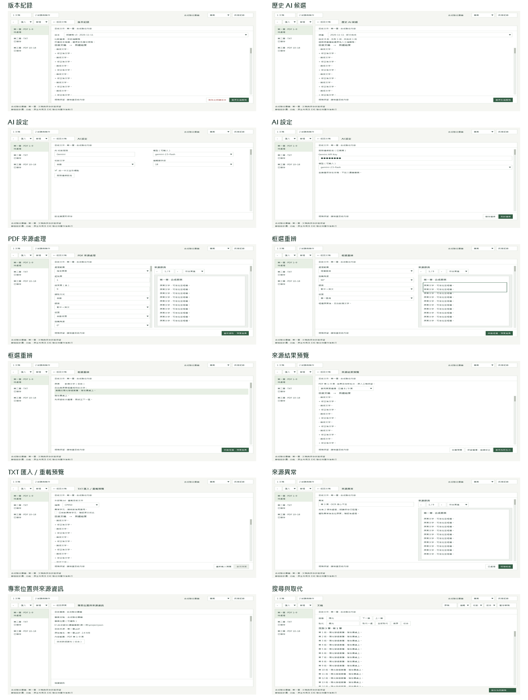

# 文稿工具與專案資訊：待確認設計

**2026-11-11更正：本批捲動設計未通過，須修正後才能送核准。** AI設定等內容已完整容納的頁面仍畫出捲軸；模板也固定滑塊長度，未根據完整內容計算。先前60張圖、連結檢查及規則文字不能證明合規。依 [捲動交付門檻](../../ui-scroll-qa.md) 重做全部狀態的量測／出圖；目前 `scroll-contract.json` 僅記一個已確認反例，完整盤點仍未完成。以下圖保留供定位問題，不作為可直接實作的核准稿。

2026-11-11。本輪僅設計，不修改產品、專案格式、v1或正式EXE。沿用已交付換行預覽的共用標頭／內容齊頭規則。設計依 AGENTS.md、frontend-visual-qa、docs/ui-components.md，以及目前 manuscript_desktop.py／manuscript_source.py 的實際入口及資料契約。圖為合成資料與靜態結構示意，尚未取得本輪布局核准，也不是原生或EXE驗收。

## 逐頁設計圖

每列均提供正常1360×820、縮小900×640、列表收合900×640的完整畫面。總覽只供找頁，確認細節請開原尺寸圖。

專案長路徑補圖：[900×640折行](project-900-long-path.png)。它與技術資料展開同屬唯讀資訊頁，不新增保存或來源處理動作。

| 頁面／狀態 | 正常 | 縮小 | 列表收合 |
| --- | --- | --- | --- |
| 版本紀錄／預覽與還原 | [圖](versions-1360.png) | [圖](versions-900.png) | [圖](versions-900-collapsed.png) |
| 歷史AI候選 | [圖](history-1360.png) | [圖](history-900.png) | [圖](history-900-collapsed.png) |
| AI偏好設定 | [圖](settings-1360.png) | [圖](settings-900.png) | [圖](settings-900-collapsed.png) |
| 連線設定展開 | [圖](connection-1360.png) | [圖](connection-900.png) | [圖](connection-900-collapsed.png) |
| PDF來源設定與原頁 | [圖](pdf-1360.png) | [圖](pdf-900.png) | [圖](pdf-900-collapsed.png) |
| 框選重辨／原頁 | [圖](region-1360.png) | [圖](region-900.png) | [圖](region-900-collapsed.png) |
| 框選重辨／對應文字 | [圖](region-text-1360.png) | [圖](region-text-900.png) | [圖](region-text-900-collapsed.png) |
| PDF結果／逐頁選擇與續修 | [圖](source-preview-1360.png) | [圖](source-preview-900.png) | [圖](source-preview-900-collapsed.png) |
| TXT匯入／重載、編碼與預覽 | [圖](txt-1360.png) | [圖](txt-900.png) | [圖](txt-900-collapsed.png) |
| 來源異常與定位 | [圖](issues-1360.png) | [圖](issues-900.png) | [圖](issues-900-collapsed.png) |
| 專案位置與來源資訊 | [圖](project-1360.png) | [圖](project-900.png) | [圖](project-900-collapsed.png) |
| 搜尋／取代（文稿內展開） | [圖](search-1360.png) | [圖](search-900.png) | [圖](search-900-collapsed.png) |

特殊狀態：[無版本](versions-900-empty.png)、[刪除確認](versions-900-confirm.png)、[無候選](history-900-empty.png)、[測試連線中](connection-900-busy.png)、[連線保存失敗](connection-900-error.png)、[擷取中](pdf-900-busy.png)、[缺OCR模型](pdf-900-models.png)、[擷取失敗](pdf-900-error.png)、[取消](pdf-900-cancelled.png)、[來源保存失敗](source-preview-900-error.png)、[無異常](issues-900-empty.png)、[略過確認](issues-900-confirm.png)、[未開專案](project-900-empty.png)、[技術資料展開](project-900-details.png)。

18pt內容：[版本](versions-900-18pt.png)、[候選](history-900-18pt.png)、[來源差異](source-preview-900-18pt.png)、[TXT](txt-900-18pt.png)、[搜尋正文](search-900-18pt.png)。18pt只作用於可調內容字級，不縮小控制項。表單欄位超出內容視口時由所屬表單捲動，不是裁掉必要能力；底部操作保持固定。

## 共用布局與原生對照

| 設計分組／空間 | 原生責任 | 實作後驗收 |
| --- | --- | --- |
| 左列表工具與右標頭同帶；兩側內容同起點 | DesktopShell／InnerPageHost、align_inner_header | 各尺寸開頁 → 量測標頭top／高度及內容top → 差≤2 Tk單位；檢查所有祖先裁切 |
| 唯一返回在標頭左側，頁名與文件／專案範圍分開 | 宿主持有標題、返回及context；頁面提供呈現資料 | 開工具 → 返回 → 原稿、游標、選取、捲動、搜尋及面板狀態保留 |
| 區域狀態靠左；適用提交靠右；窄版必要時狀態與動作分兩列 | 共用ActionBar／ActionSpec | 長錯誤 → 文字折行且動作完整；反覆切換 → 僅目前命令有效、dispatcher不累積 |
| 長差異／清單由內容Text或Treeview捲動；表單只有一個Canvas | 內容模組；不在表單Canvas裡再嵌差異捲動 | 滾輪／捲軸／Ctrl+Home／End → 首末可達 → 標頭、操作列固定 |
| PDF寬版設定與原頁並列；窄版「設定／原頁／對應文字」具名切換 | SourceTools內容布局；保留同一頁碼、縮放、旋轉與選區 | 切原頁 → 清楚讀文並框選 → 切文字反白 → 回來選區不變；不可只用縮圖代替原頁 |
| 收合移除整欄及間距，標頭保留可聚焦重開圖示 | shell列表／宿主reopen與共用提示 | 收合 → 主內容增寬 → 鍵盤重開 → 選取／列表捲動不變 |

首次匯入另圖：[PDF正常](pdf-1360-import.png)／[PDF窄版](pdf-900-import.png)、[TXT正常](txt-1360-import.png)／[TXT窄版](txt-900-import.png)。匯入建立新批次；重載先備份現稿，使用不同提交名稱。TXT圖含待核對字元，因此匯入／套用在未勾核對時停用；沒有警告時隱藏該核對區，不改既有正常匯入契約。

實作尺寸：最大化（記實際客戶區）、1360×820、1280×720、900×640，適用18pt。內容門檻按任務分配：版本／候選正常差異視口≥350高、900×640≥180；搜尋收合／展開後正文在900×640、18pt至少8行；TXT含異常核對、PDF結果含逐頁選擇時差異區≥150高，18pt至少4行，長結果以唯一差異捲動到達首末。這些頁因固定前置欄位占用空間，不套用換行預覽頁的280高門檻。原頁寬版可讀區寬≥320；窄版切原頁後使用整個內容寬。表單可捲動，但主要操作不能跟著捲走。長錯誤允許暫占更多操作列高度，仍需能到達內容末端。

## 功能與入口對照（不以布局代替）

| 能力 → 既有入口 | 設計入口／狀態持有者 | 必保留的功能與保護 |
| --- | --- | --- |
| 版本紀錄／唯讀差異／還原／刪除 → 版本選單 | 共用宿主版本頁；workflow持版本，文稿控制器持現稿 | 還原前備份；還原後需重存朗讀稿；只對適用朗讀版本顯示刪除；刪除先明確確認，取消為預設；錯誤留現稿 |
| 歷史AI候選 → 版本選單 | 同一版本模組以候選篩選進入，不新建第二個版本系統 | 完成／部分／失敗／過期可辨；舊候選僅還原人工稿，不讓舊工作覆蓋新稿 |
| AI文字／標點／字級／自訂模型 → 校對→AI設定 | 偏好頁，保留既有變更即保存；原狀態由app／workflow持有 | 自訂模型可輸入；重載保留選值；保存失敗保留輸入並明示未保存，不新增重複保存入口 |
| 金鑰儲存／測試 → 服務連線設定 | 同頁按需展開；連線動作在所屬區域，工作由app持有 | 安全金鑰僅本機；測試沿用先儲存連線契約；錯誤不丟欄位；忙碌時停用衝突操作，只顯示適用取消 |
| PDF匯入／來源設定／重擷取／失敗頁重試 | 匯入選單／來源→來源處理；SourceTools＋原工作服務 | 起訖含尾頁；範圍、語言、版面、旋轉、OCR模型保留；模型缺少時提供安裝；先預覽再採用，原來源不改寫 |
| 框選／對應文字／逐頁採用／續修 | PDF處理範圍→框選區域；原頁與文字具名視圖 | 保留頁碼、縮放、旋轉、框選及反白；選中頁面存新批次，原人工稿保留；保留前次接受結果，放棄只捨棄適用預覽 |
| TXT匯入／外稿重載／換編碼 → 匯入或編輯→重載 | TXT預覽；同模組按「匯入／重載」情境供適用動作 | UTF-8/BOM/UTF-16/BOM/Big5/CP950；錯編碼可重選；異常核對未勾時禁止套用；重載先備份，匯入新批次，不混提交名稱 |
| 來源異常→來源選單 | 同模組異常頁；來源記錄持狀態 | 選異常→定位原頁→已處理或明確略過；略過需確認，未解仍阻擋朗讀；無異常隱藏處理動作 |
| 專案位置與來源資訊→header專案選單 | 獨立唯讀專案資訊頁，不再呼叫來源處理頁 | 保留完整可選取位置、原名、檔案大小；依PDF/TXT顯示適用範圍；長路徑折行，技術識別按需展開；未開專案仍有建立／開啟入口；返回原步驟及其草稿／頁籤 |
| 搜尋／取代→編輯／Ctrl+F/H | 同一全文編輯區內搜尋列 | 找前／後、計數、取代一處／全部、復原、收合、選取及上下文；沒有另建全文編輯器 |
| 匯出全文TXT／暫存／復原／AI差異與游標還原／放棄候選 | 保留文稿既有編輯、校對入口及同一全文編輯器 | 匯出畫面全文；放棄先備份人工候選；AI部分失敗／取消／過期保護與朗讀快照原子一致保留；這些直接命令不另造空內頁 |
| 開啟來源PDF | 保留來源選單、系統PDF閱讀器 | 保留實體路徑與缺檔提示；不是同窗新工具頁 |

## UI規範逐項落實

1. 先選版本／範圍／編碼，再檢查內容，最後執行區域動作。
2. 工具留同一宿主；返回原入口。搜尋留編輯器內。系統選檔及外部PDF維持既有例外。
3. 共用摘要一列；模型連線、技術識別及長說明按需展開。
4. 差異／原頁取得剩餘高度；寬表單可兩欄，窄表單改單欄。
5. 無整頁包內捲動、無水平捲動。原頁與設定為平行捲動擁有者，窄版改具名切換。
6. 固定操作區；返回只一處；主／次／刪除可辨。窄版動作不擠壓狀態文字。
7. TXT不顯示OCR；候選不顯示朗讀版本刪除；無異常、無版本、未開專案依情境隱藏動作。
8. 常用值用下拉，自訂模型可輸入；欄位與選值保存／重載依既有契約。
9. 不恢復已核准移除的文稿AI傳送同意框。TXT異常核對是另一種保護，未勾禁止採用。其他既有需傳送同意的流程仍遵守預設勾選及取消阻擋，不擴張本輪範圍。
10. 啟動最大化；指定縮小尺寸不縮字塞操作。18pt只放大正文。
11. 處理中／失敗／取消／空狀態／成功明示。狀態圖僅示意，不把假結果帶入產品。忙碌時停用衝突的切頁、匯入及提交；只顯示適用進度和取消。
12. 本輪設計待確認；核准後才實作。驗收用單動作與可觀察結果。
13. 同角色控制項37設計單位高、相鄰操作間距4，原生驗收允差≤2 Tk單位；下拉箭頭由元件提供一次。圖示有名稱／提示／焦點及展開狀態；最終依元件規範實測。

圖內「｜」欄位為控制項布局示意，完整選項及可用狀態以上述功能契約為準。模型名稱是既有選項示例，不代表最新模型建議。正文及原頁為合成文字。程式繪圖無法證明滾輪、鍵盤、保存、框選或原生元件可用；所有功能回歸、原生布局與正式EXE驗收均待後續實作。本輪沒有啟動應用、瀏覽器、測試服務或建置，沒有新增背景程序／依賴／測試暫存。正式EXE雜湊仍為 `6fc22828987f435215f01383d248e1f13f5551ec6e446f445f96b0aef3be74aa`。
