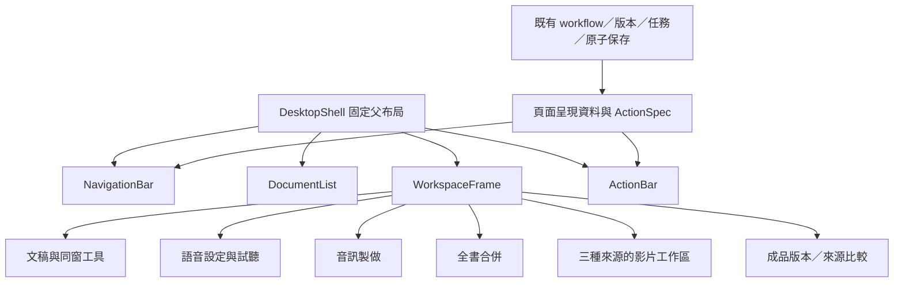
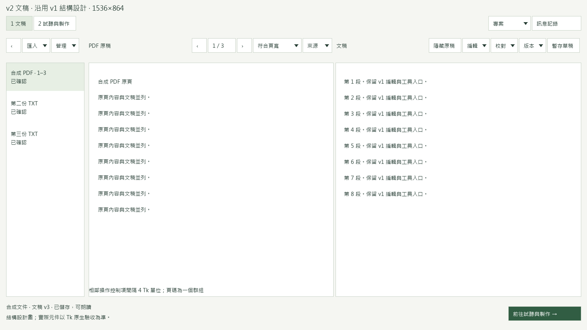
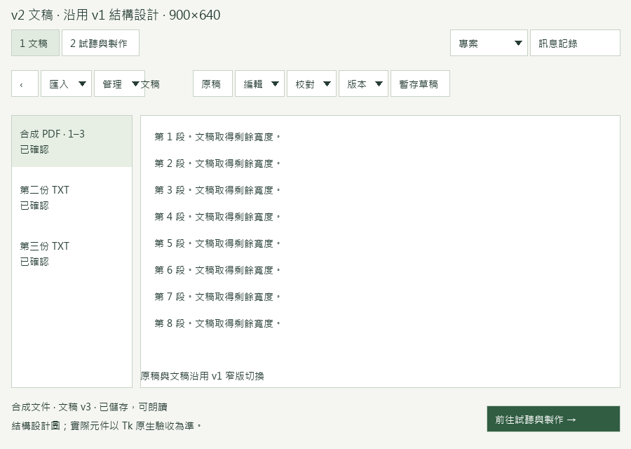
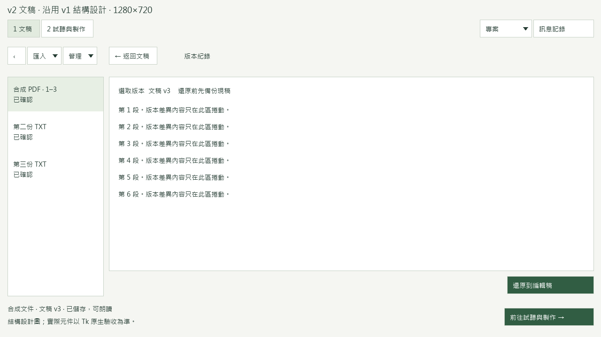

# v2 全頁布局設計

> 狀態：CLOSED／SUPERSEDED（2026-11-13，舊執行計畫）。共用外框責任、全頁接入順序及完成判定由[新spec](v2-unified-shell-spec.md)／[新ticket](tickets/v2-unified-shell.md)取代。下文保留歷史功能／布局與當時交付；不是當前完整接入狀態，也不是新外框核准圖。

2026-11-11追加：目前文稿主介面與「整理換行預覽」完成共用模組接入；本內頁的新齊頭布局、唯一返回與區域操作已在本session核准並交付。見 [核准布局](tickets/v2-linebreak-preview.md)／[原生及EXE證據](verification/v2-linebreak-preview/README.md)。其他工具與製作頁仍待逐頁確認及接入，下文既有計畫不擴張完成範圍。

2026-11-11。共同外框沿用 v1 的顏色、字體、尺寸、導覽及操作順序。文稿頁依本輪使用者指示實作；其他內容頁下列圖為遷移設計，尚未接入新框架，不代表已核准新增布局。功能／狀態對照另見 [模組計畫](v2-ui-module-plan.md)。

## 共用外框與介面

```text
┌ 1 文稿  2 試聽與製作  [目前製作子流程] ────── 書名  專案  訊息 ┐
├ 匯入 管理 ──┬ 標題／目前範圍／區域工具 ──────────────────────────┤
│ 文件列表    │                                                  │
│ 選取／捲動  │ 專屬內容頁：只管理此區，不搬動其他區控制項         │
│             │ 每個長文／清單有獨立捲動擁有者                    │
│             │ 區域狀態／錯誤／適用同意                          │
├─────────────┴──────────────────────────────────────────────────┤
│ 一列共用摘要                                                   │
│ 返回／次要操作                       成品操作／取消／主要下一步 │
└────────────────────────────────────────────────────────────────┘
```

主框架只建立一次。正常 1536×793（本機最大化實測）／1360×820：製作導覽在寬度足夠時與主導覽同列。1280×720 或寬度不足時按完整群組換列。900×640：子流程換列、正文使用剩餘高度，列表可收合，主要操作按角色重排。工具展開保留主步驟選取與底列，由工作區切換內容；離頁保留設定，製作任務不停止。



## 各內容頁正常布局

```text
文稿                            語音設定與試聽
PDF 標題／頁碼／縮放／來源       已存設定／歷史任務 → 載入
原稿 1:1 │ 文稿與編輯／校對      服務／模型／服務管理
原頁捲動 │ 全文獨自捲動          聲音／語速／節奏 │ 試聽全文
         │ 版本／暫存            全書／本批設定   │ 同意／播放／停止
共用摘要 → 儲存／前往製作        返回文稿        儲存／前往音訊

音訊製做                        全書合併
歷史任務選擇 → 朗讀稿與設定      選批／順序 → 接點／交接停頓
區塊／狀態／嘗試／說明清單      批次來源表格獨自捲動
清單獨自捲動並取得剩餘高度      MP3／MP4 各自準備與結果
一列狀態／同意／詳情／重檢      設定保存狀態／部分完成
返回／重來  成品／主要任務       返回批次  保存／只做未完成格式

影片工作區                      成品版本
本批／全書 → 統一素材／各批      三種成品路徑／狀態／來源
畫面素材｜來源順序｜任務成品    總音訊／總音訊製片／批次影片合併
真實 16:9 預覽／定位／停止      表格獨自捲動
適用素材／短片模式／解析度      選取成品的來源與設定比較
返回  保存  成品／製作或重試     返回  播放／停止／另存／前往來源
```

## 縮小與工具展開

| 頁面 | 900×640／寬度不足 | 工具展開／返回 | 設計門檻與驗收 |
| --- | --- | --- | --- |
| 文稿 | 以原稿／文稿切換；工具群換列；列表收合釋放欄與間距 | 版本、AI 設定、來源處理、換行預覽切換同窗完整內容；搜尋留編輯區 | 編輯區 ≥360 高，18pt ≥8 display lines；正文三區 y 差 ≤2；PDF 動作間距 4 |
| 語音 | 服務獨立一列；聲音設定與試聽保留既有窄版上下重排 | 服務管理／本機套件／全書預設在同一宿主切換，保留未存設定及同意 | 不裁切服務選擇、試聽、儲存及返回；長試聽文字末行可達；控制項高度差 ≤2 |
| 音訊 | 導覽換列；任務工具收成具名入口，清單保留主要高度 | 朗讀稿／設定／錯誤取代清單，返回恢復清單選取及捲動 | 1536×864 至少6列、1280×720 至少4列；900×640 主要任務與同意完整可達 |
| 合併 | 共用選批表優先；設定按需展開，格式結果保持各自狀態 | 接點檢查、素材設定及成品版本有明確返回，原順序／停頓不變 | 1280×720 至少4來源列；900×640 固定返回與主要動作；長清單首末可達 |
| 影片 | 三個真正頁籤保留；適用設定換列，不增加整頁捲動 | 素材／來源／任務各頁籤保留狀態；離頁停止預覽，製作繼續 | 1280×720 預覽保持16:9且至少320×180；900×640 可切換完整預覽／設定並保留上下文 |
| 成品版本 | 表格欄位按優先度給寬；技術識別放詳情，不以水平捲動塞入 | 來源比較取代表格，返回保留路徑／選取；製作入口帶回正確來源方式 | 三種路徑可分辨；900×640 播放、停止、另存與返回可達；詳情末行可達 |

上述其他頁門檻為後續遷移的設計驗收標準，尚未宣稱本輪完成新框架原生驗收。18pt 情境作用於原本允許調整的內容字級，不以縮小系統顯示通過。各頁共用同一控制項樣式與間距來源。

文稿的正常、縮小與工具展開設計圖：





其餘頁延續現行有效參考：[音訊票](tickets/audio-production-ui.md)、[影片票及配套 mock](tickets/unified-video-workspace.md)、語音／全書合併／成品版本以封存 v1 實際頁面為基線。未來若調整內容布局，須先提交對應正常／縮小／工具圖確認；不因本文件建立而改動這些頁面。
