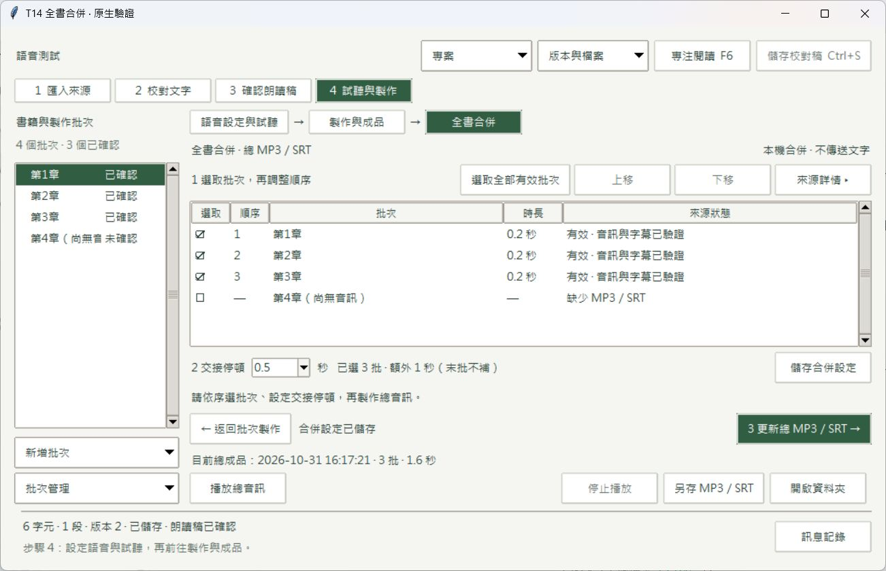

# T14：全書合併總 MP3／SRT

正式版本：`dist/T14/ebook2mp4/ebook2mp4.exe`。搬移時保留整個 ebook2mp4 資料夾。SHA-256：`149b50c8352e4c1c182bc8d50dc1a09319d2612d680b2ad674fe203108f4f5c2`。

使用者已確認 [HTML 提案](../T14-ui-proposal.md)。實作保留 T13 版面，在「試聽與製作」內新增「全書合併」。原有語音設定、試聽與批次製作頁不重排。

## 已完成行為

- 在同一主視窗勾選、排序、保存全書合併清單。點列再上移／下移；空白鍵切換勾選，表頭不切換。預設未選；重開載入已存順序。設定以書籍為範圍，不依單批選取分裂成不同清單。
- 共用設定保存批次識別、MP3／SRT 版本、朗讀稿與語音設定識別及交接停頓。預設 500 ms，可選常用值或手填秒數，最多三位小數。此設定供後續總影片共用，T14 不顯示未實作的影片輸出。
- 來源清單在可取消背景工作中驗證 SHA、完整解碼及 SRT。逐列顯示缺少、稿件／語音待更新、損壞與字幕時間錯誤；詳情與修復入口在同一內容區。失效來源不能新選，已保存的失效選取可取消。
- 合併僅使用批次 MP3／SRT，不需要圖片、OCR、背景或 MP4，不呼叫 TTS。任務複製並核對固定來源快照，解碼成 24 kHz PCM，逐批完整接續原有頭尾，只插入 N−1 段額外交接靜音。
- 字幕依實際來源幀數位移，受總幀邊界限制。新增交接靜音不顯示字幕。最終 MP3 再完整解碼；MP3 尾部少量樣本量化差容許最多 1 ms，超過即拒絕發布。保存實際解碼與計畫幀數，不用估算字速或影片時長。
- 同專案沿用既有 Windows 產出鎖。主執行緒取得／釋放 mutex 並原子發布索引；大檔雜湊、解碼、播放前驗證及另存在可取消背景工作執行。忙碌時停用衝突操作。
- 媒體階段最多三次嘗試；明確重試另建任務。取消、失敗、磁碟不足與寫入衝突保留舊成品及進度。發布前若已驗證輸出檔的檔案狀態變更，也拒絕替換舊成果。
- 選取、順序、停頓或已選來源變更時標示待更新；未選批次及視覺設定不影響總音訊。舊成品仍可播／另存。舊總成品損壞時，仍可用有效批次重新合併。
- 保存、製作、另存及失敗接共用通知／訊息記錄。離頁取消待播驗證並停止播放；關閉會等待工作停止並再次釋放播放器。

公開入口：`assembly_settings`、`save_assembly_settings`、`inspect_assembly`、`start_total_audio`、`finish_total_audio`、`discard_total_audio`、`total_audio_runs`、`total_audio`、`total_audio_path`、`export_total_audio`。

## 驗收路徑

以下採 ASD-STE100 風格中文：短句、單一動作、可觀察結果，不宣稱符合英文受控詞彙標準。建議建立測試書籍，準備 A、B、C 三批已確認且已完成的 MP3／SRT。不要用正式書籍做刪檔或損壞測試。

| ID | 操作路徑 | 檢查結果 |
| --- | --- | --- |
| 1 | 按「試聽與製作」→ 按「全書合併」→ 等待檢查完成 | 同主視窗顯示批次來源。沒有新視窗。 |
| 2 | 勾 A、B、C → 點 C 列 → 按「上移」→ 按「儲存合併設定」→ 重開專案 | 順序保持 A、C、B。交接停頓保持 0.5 秒。 |
| 3 | 只選 A → 按「製作總 MP3／SRT」→ 檢查總音訊 | 沒有額外交接靜音。沒有 TTS 請求。 |
| 4 | 選 A、B → 使用 0.5 秒 → 製作 → 檢查音訊與 SRT | 比來源解碼總長增加 500 ms。新增靜音沒有字幕。 |
| 5 | 選 A、B、C → 使用 0.5 秒 → 製作 → 檢查音訊與 SRT | 額外增加 1,000 ms。末批後不補靜音。字幕依序且不重疊。 |
| 6 | 選無效來源列 → 按「來源詳情」→ 按「前往此批次製作」 | 顯示原因。導向該批次。返回保留全書選取與順序。 |
| 7 | 合併完成 → 改順序或停頓 → 按「儲存合併設定」→ 播放舊成品 | 顯示「待更新 · 上一版總成品」。舊成品可播。 |
| 8 | 更新已選 A 的稿件或語音 → 返回全書合併 → 檢查來源 → 再修改未選批次 | 已選來源待更新。未選批次變更不影響總音訊。 |
| 9 | 開始長檔檢查或合併 → 按「取消任務」→ 等待停止 → 播放舊版 | 主窗可操作。取消完成後進度及取消按鈕隱藏。舊成品完整。 |
| 10 | 開始批次製作 → 開全書合併 → 檢查儲存與製作按鈕 | 衝突操作停用。顯示另一任務忙碌原因。 |
| 11 | 合併成功 → 按「播放總音訊」→ 按「停止播放」→ 再播放並切到語音頁 | 狀態顯示播放／停止。離頁不再播放，待播驗證也不會在隱藏頁啟動。 |
| 12 | 按「另存 MP3／SRT」→ 輸入新資料夾名稱 → 按「開啟資料夾」 | 新資料夾有兩檔。內容與總成品一致。不覆寫已存在資料夾。 |
| 13 | 在測試書籍製造讀檔失敗或磁碟不足 → 開始合併 → 等待失敗 → 解決原因 → 明確重試 | 原因可見。嘗試次數有限。舊成果及可驗證進度保留。 |
| 14 | 在測試書籍移除舊總 MP3 → 重開全書頁 → 選有效批次 → 製作 | 舊成品不可播，但有效來源可載入並重新完成。 |
| 15 | 啟動 → 還原至 1040×640 → 操作清單及詳情 → 最大化 → 關閉 | 啟動最大化。必要操作可見。沒有整頁外層或水平捲動。關閉後沒有本次程序或檔案占用。 |

## 已執行證據

- 完整回歸：38 模組、223 案例全過，0 跳過，759.31 秒，含真實三語 OCR 與原指定 PDF。見 [`suite-final-summary.json`](T14/suite-final-summary.json) 與 `suite-final/`。首次沙箱執行遇 DPAPI 解密限制而中止；其日誌保留於 `suite/`，本次程序樹已停止，再於目前 Windows 使用者環境跑完整套件。沒有把初次失敗改標成功。
- 額外發布保護 1 案例通過；共 224 個不同案例。最終播放狀態修改後，5 項 GUI 全過。見 [`publication-guard.txt`](T14/publication-guard.txt)、[`gui-final.txt`](T14/gui-final.txt)、[`final-summary.json`](T14/final-summary.json)。
- 型別：25 來源檔使用 `--check-untyped-defs`，全部通過，見 [`typecheck-final.txt`](T14/typecheck-final.txt)。
- 真實媒體：[`real-media.json`](T14/real-media.json) 記錄 1／2／3 批解碼長度 200／900／1,600 ms，額外靜音 0／500／1,000 ms；交接靜音中段峰值均為 0；每次新增 TTS 請求為 0。使用合成音訊服務替身及真實 FFmpeg，不是線上服務測試。範例成品保留於 `media/`。
- 不整毫秒：[`fractional-red.txt`](T14/fractional-red.txt) 與 [`fractional-green.txt`](T14/fractional-green.txt)，先重現 MP3 尾部樣本量化及字幕重疊風險，再通過修正。錯誤字幕與媒體失敗、取消、磁碟不足、來源版本、跨窗衝突及未選批次隔離亦在公開工作流程測試中驗證。
- 原生：最終 [1040×640](T14/native-1040.png)、[缺少來源詳情](T14/native-details-final.png) 及 [正式封裝最大化](T14/package-final.png)。原生控制項另於 1040×640／1360×800 重跑邊界與忙碌操作測試，見 [`native-size-final.txt`](T14/native-size-final.txt)。現場約 125% DPI；其他 DPI 未測。HTML 檢查與原生檢查分別記錄。
- 正式封裝：原生選檔開合成專案 → 加選第三批 → 排 A、C、B → 合併 → 重開 → 再合併 → 播放結束 → 正常關閉。保存順序、最終解碼 1,600 ms、批次語音任務數仍各 1、沒有鎖殘留，見 [`package-journey.json`](T14/package-journey.json)、[播放結束](T14/package-playback.png)。最後封裝 23 個來源模組比對一致，1,299 個檔案，見 [`package-source.json`](T14/package-source.json)。
- 審查：兩個原審查者均複查至 `0ea80a4`，Standards 0、Spec 0，見 [雙軸審查](T14-review.md)。
- 清理及正式封裝檔獨占開啟／釋放結果見 [`cleanup.json`](T14/cleanup.json)。保留正式版本、需求、草圖及證據；不動使用者書籍、模型、T13 或正式續作原音。

本次音訊證據為短合成音調，未驗真實書籍長時間聽感。沒有執行 Gemini／Fish 付費合成，T14 也不需要它們。WAV 組裝目前明確限制約 23 小時，超過會在開始前提示減少批次／停頓。T15 交接試聽與影片仍是後續工作。
