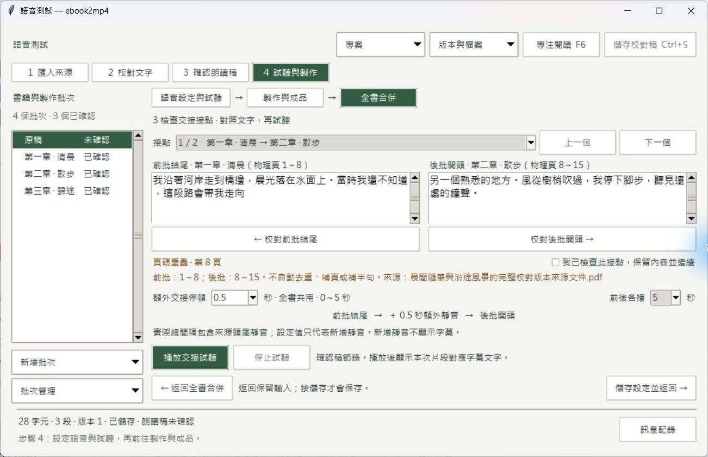

# T15：交接試聽與 PDF 頁碼銜接

正式版本：[ebook2mp4.exe](../../dist/T15/ebook2mp4/ebook2mp4.exe)。搬移時保留整個 `dist/T15/ebook2mp4` 資料夾。

SHA-256：`60c3d124402fb0ef279c805ac127e54692dd2bbc7984de2dba5fce5441956ae2`。

使用者確認 [HTML 草圖](../T15-ui-proposal.md) 後實作。沿用四步驟及全書合併版面，新增同主視窗的接點檢查內頁。實作 `b5f7eee`，審查修正 `437b5b7`；不推送。

## 已完成行為

- 額外交接停頓預設 0.5 秒；常用候選及手填均支援 0～5 秒，最多三位小數。設定及已確認警告可保存重開。舊版超過 5 秒的設定可讀，但必須調整再保存／製作，不暗改舊值。
- 接點顯示前批結尾、後批開頭與物理頁範圍。初始為音訊對應的確認稿節錄；試聽後改顯示實際片段對應的字幕文字。可選前後各 3、5、10 秒；短來源保留整段。來源原有頭尾不裁成有聲端點，新增停頓以外仍可能有來源靜音。
- 試聽在可取消背景工作驗證來源雜湊、完整解碼、字幕及來源版本，重用批次 MP3／SRT，不呼叫 TTS。預覽及正式總音訊共用新增靜音規則。字幕依實際幀數位移；新靜音沒有字幕。小於一毫秒的交界 cue 量化成零時長時略過，不拒絕有效試聽。
- 初次選取 PDF 時，各同來源文件依物理起始頁排序；既有保存順序及手動順序優先。TXT 保留名稱及手動順序，沒有假頁碼。同來源 PDF 的相鄰接點顯示重疊、缺口及倒序；每個有警告的接點須明確確認，仍可選擇保留內容。沒有自動去重、補頁、搬字或補半句。
- 警告確認綁定前後批次、頁範圍、來源、朗讀稿與音訊版本。來源或接點變更須重查；只改停頓保留頁碼確認。正式製作公開入口也阻擋未確認警告，不只停用 UI 按鈕。
- 可直接返回對應批次校對。底部提供返回接點入口；保留全書選取、順序與未存停頓。修改後仍須重新確認朗讀稿、更新音訊。多本書的返回入口各自連回目前書籍。
- 離頁停止播放器及取消待播準備，隱藏頁不自動開始播放。完成、失敗或取消後釋放本次預覽暫存；關閉等待工作停止。設定變更使總成品待更新，批次成品及舊總成品保留。

公開入口：`inspect_assembly_joins(batch_ids=None)`、`start_assembly_join_preview(batch_ids, index, pause_ms=500, clip_ms=5000)`、`finish_assembly_join_preview(job)`、`discard_assembly_join_preview(job)`。`save_assembly_settings` 新增關鍵字參數 `accepted_joins`。預覽完成後先停止播放器，再捨棄工作以釋放檔案；不將預覽當成正式成品保存。

## 驗收路徑

以下採 ASD-STE100 風格中文：短句、單一動作、可觀察結果。不是英文受控詞彙標準認證。請建立測試書籍，準備 A、B、C 三批有效 MP3／SRT。PDF 可使用同來源的 1～8、8～15、18～20 頁。

| ID | 操作路徑 | 確認結果 |
| --- | --- | --- |
| 1 | 按「試聽與製作」→ 按「全書合併」→ 初次勾選 PDF 批次 | 同來源批次依物理起始頁排列。可上移／下移。 |
| 2 | 輸入 0 秒 → 按「儲存合併設定」→ 重開 → 依序使用 0.5 及 5 秒 | 保存值不變。負數、5.001 秒及超過三位小數無法保存。 |
| 3 | 勾 A、B → 按「對照文字與試聽接點」 | 前批結尾在左。後批開頭在右。仍在同一主視窗。 |
| 4 | 設定 0 秒 → 按「播放交接試聽」→ 依序使用 0.5 及 5 秒 | 新靜音分別為 0、500、5000 ms。保留來源頭尾。沒有新增 TTS 請求。 |
| 5 | 選前後各播 3、5 或 10 秒 → 播放 → 按「停止試聽」 | 長來源使用所選片段長度。短來源使用全部可用音訊。停止後不再播放。 |
| 6 | 選 1～8 與 8～15 頁 → 檢查警告 → 勾「我已檢查此接點，保留內容並繼續」 | 顯示重疊第 8 頁。確認後可繼續。沒有自動去重。 |
| 7 | 加選 18～20 頁 → 按「下一個」→ 檢查警告 → 明確勾選 → 保存 | 顯示缺少第 16～17 頁。每個警告各自確認。不自動補頁。重開保留確認。 |
| 8 | 按「校對前批結尾」或「校對後批開頭」→ 修改 → 按底部「返回全書合併的接點檢查」 | 開啟正確批次。全書輸入保留。須重新確認朗讀稿及更新音訊。 |
| 9 | 改接點順序或更新所選批次音訊 → 回到全書合併 | 變更的接點警告須重新確認。舊音訊不冒充新稿。 |
| 10 | 選 TXT 批次 → 改順序 → 開接點檢查 | 名稱及手動順序保留。沒有 PDF 頁碼警告。 |
| 11 | 只選 A → 檢查接點入口 → 製作 | 接點入口停用。沒有額外交接靜音。 |
| 12 | 分別選一、二、三批 → 分別使用 0、0.5、5 秒 → 製作 → 解碼並檢查 SRT | 額外總長為 N−1 乘停頓。末批不補。字幕依實際時間位移；新增靜音無字幕。 |
| 13 | 完成總音訊 → 改順序或停頓 → 保存 → 播放舊總成品 | 總成品標待更新。批次 MP3／SRT 不變。舊總成品仍可播放。 |
| 14 | 在測試書籍破壞來源 → 開接點 → 嘗試播放及製作 | 原因可見。無效來源不能試聽或合併。沒有新 TTS 請求。 |
| 15 | 開始準備試聽 → 切到語音頁或關閉程式 → 等待停止 | 隱藏頁不播放。沒有本次預覽資料夾、程序或檔案占用。 |
| 16 | 啟動 → 還原至 1040×640 → 操作文字及底部按鈕 → 放大視窗 | 啟動最大化。必要操作可見。沒有重疊、裁切或水平／雙層捲動。 |

## 驗證證據與限制

- 完整回歸、最後相關重跑、型別、正式封裝來源一致性及清理總數見 [`final-summary.json`](T15/final-summary.json)。完整套件每個模組獨立執行，結果見 [`suite-summary.json`](T15/suite-summary.json) 及 `suite/`；原先未提交 TTS 測試亦納入目前工作區回歸，沒有將其內容提交為 T15 工作。
- 真實 FFmpeg 預覽 0／500／5000 ms 的交接，實測總長 400／900／5400 ms；三批總音訊 0.5 秒停頓為 1600 ms。見 [`real-media.json`](T15/real-media.json) 及 `media/`。一至三批全組合另由公開工作流程測試驗證。
- 正式封裝：原生選檔 → 開合成專案 → 檢查重疊及缺頁 → 各自確認 → 設 5 秒 → 本機試聽 → 前往後批校對 → 底部返回接點 → 保存 → 合併總成品 → 正常退出。重開資料及真實解碼確認 10,600 ms、兩個警告已確認、每批語音任務仍各 1、沒有預覽暫存或鎖。見 [`package-journey.json`](T15/package-journey.json)、[完成畫面](T15/package-total-complete.png)。
- 正式封裝 26 個載入來源模組與目前工作區編譯碼一致，含本次兩個接點模組；見 [`package-source.json`](T15/package-source.json)。封裝包含工作區原有 TTS 控制更新；其原始碼及既有未提交狀態保留。
- 視覺檢查：1040×640／1360×800 原生控制項邊界、正式封裝還原視窗與長檔名警告已檢查。原生 UI 約 125% DPI；其他 DPI 未測。沒有整頁外層捲動；前後文字獨立捲動。
- [雙軸審查](T15-review.md)：原審查者均複查至 `437b5b7`，Standards 0、Spec 0。

音訊證據使用合成音調服務替身及真實 FFmpeg；沒有執行線上 TTS，也沒有宣稱完成人工聽感或真書長時間播放驗收。本張不提供影片最後一格預覽。原有總音訊 WAV 組裝約 23 小時上限保留。

清理見 [`cleanup.json`](T15/cleanup.json)。正式成品、設計、需求與最終證據保留。使用者資料、其他版本及正式 `voice-blocks` 續作資料不動。
