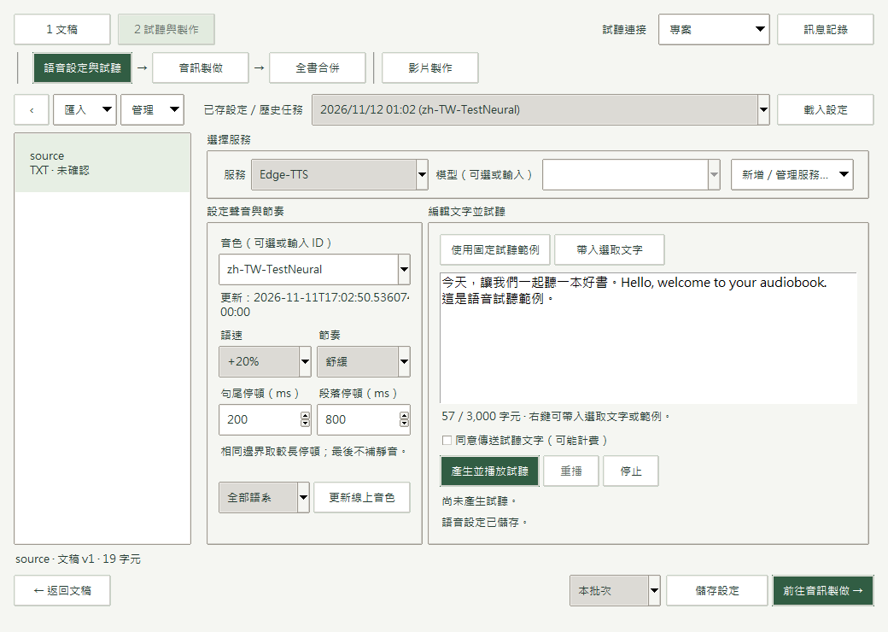

# 語音設定保存與原任務恢復

2026-11-05。正式成品：`dist/ebook2mp4/ebook2mp4.exe`。

## 完成行為

- 按「儲存設定」，按台灣當下時間自動命名為 `YYYY/MM/DD HH:mm (音色)`。保存完整參數；同名記錄使用獨立識別，不覆寫歷史記錄。
- 「已存設定／歷史任務」選單提供已存設定及原任務完整快照。按「載入設定」後需明確儲存；未存變更時「前往製作」停用。
- 製作頁設定不同時提供「恢復原任務設定」。恢復只更新本批次，保留原任務及有效語音區塊；同步語音頁。未存語音調整先確認是否取代。
- 分開顯示稿件與設定差異；恢復設定不會清除稿件差異。取消的傳送同意在切換、重檢及恢復後仍維持取消。
- 原任務快照與音訊快取規則保持不變；來源名稱不加入音訊快取識別。金鑰不寫進專案。

## 驗證

原生 Windows 執行 20 項測試通過：

- 設定保存、重開、恢復與寫入失敗：3 項，`voice-settings-recovery-native.txt`。
- 既有語音桌面操作：6 項，`voice-settings-desktop-tests.txt`。
- 已完成區塊重用、取消、恢復與離線組裝：6 項，`voice-settings-resume-tests.txt`。
- 主視窗與製作頁往返：3 項，`voice-settings-production-tests.txt`。
- 單一儲存、完整參數載入、未存導航阻擋、製作頁實際恢復、同意保留、1040×740 控制項邊界：2 項，`voice-settings-ui.txt`。

沙箱內 Windows asyncio 測試逾時；原生環境重跑全數通過。未呼叫付費雲端 TTS，服務請求由測試替身提供。

最終 PyInstaller 建置成功：`voice-settings-build-final.txt`。使用封裝檔案讀取器遞迴比較五個修改模組的位元碼、常數與行號資料，全部與目前原始碼一致：`voice-settings-package.json`。正式 EXE 啟動後正常關閉，程序已結束：`voice-settings-release.json`。

## 操作驗收

1. 選好音色 → 按「儲存設定」 → 檢查來源選單顯示目前時間與音色。
2. 調整語速 → 檢查「前往製作」 → 確認停用。
3. 選取原先設定 → 按「載入設定」 → 確認完整參數還原。
4. 按「儲存設定」 → 按「前往製作」 → 選取原任務。
5. 當設定不同 → 按「恢復原任務設定」 → 確認設定差異解除。
6. 按「繼續未完成區塊」 → 檢查區塊清單 → 確認有效區塊重用。

本次建置依賴與建置快取在驗證後清除；保留正式成品、需求、設計與最終證據。未移除工作前已存在的兩個 2026-11-02 測試目錄。已確認本次測試、建置及啟動驗證程序均結束。
