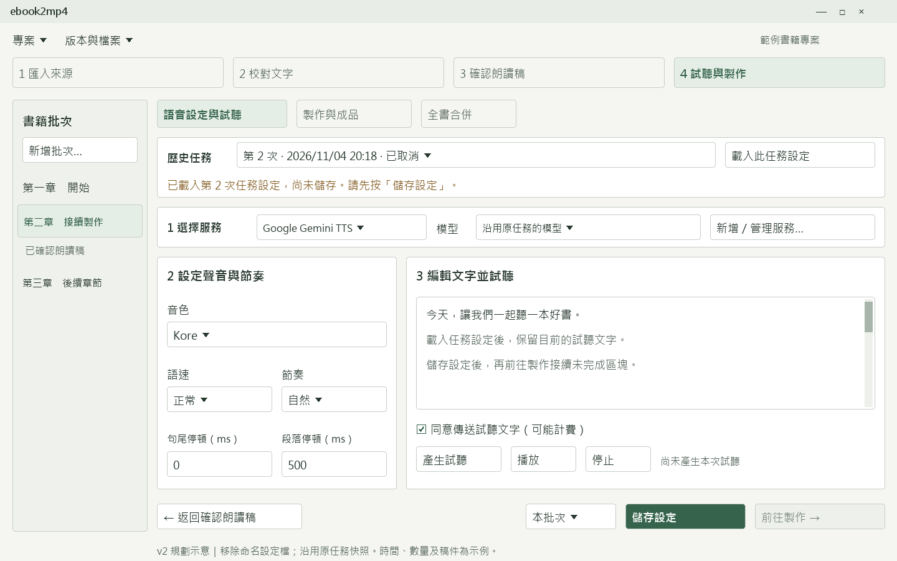
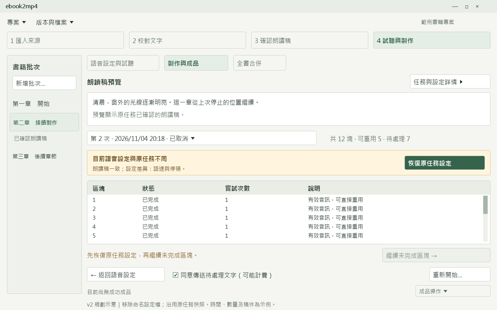

# 原任務語音設定載入與續作規劃（精簡版）

日期：2026-11-05。狀態：已依核准設計完成實作，正式成品為 `dist/ebook2mp4/ebook2mp4.exe`。

最新核准修訂：按「儲存設定」自動以台灣時間及音色命名，例如 `2026/11/05 16:29 (Zephyr)`。每次儲存保留獨立記錄，來源選單可直接載入；同分鐘同音色以獨立識別保存。仍只有一個儲存入口，不提供手動命名或另存。此項優先於下方原精簡提案中的「不新增設定檔」敘述。完成結果與證據見 [實作驗證](verification/voice-settings-recovery.md)。

本次修訂依使用者要求精簡 UI 與功能：移除「另存設定檔」及命名設定檔管理；全頁只有一個「儲存設定」按鈕。「前往製作」只負責切頁，有未存調整時停用。本文件及 v2 設計圖取代前版命名設定檔提案。

## 要解決的問題

使用設定檔 A 產生部分區塊後，使用者需要在重開專案時找回 A。若目前設定已變成 B，使用者需要在「製作與成品」一鍵恢復 A，再接續原任務。

直接使用現有「本批次已儲存設定」及「原任務設定快照」。A、B 只用來說明不同參數，不新增需要命名、另存或管理的設定檔。從歷史任務載入完整參數，即可找回原來的聲音設定。

## 現況與原因

- `ebook2mp4/voice_desktop.py` 的 `load_settings()` 已讀取本批次或全書預設的已儲存設定。它不會列出或載入歷史製作任務使用的設定。
- `ebook2mp4/tts_services.py` 的服務設定檔保存服務名稱、服務類型及本機憑證連結，未包含完整音色、模型、語速與停頓。選回同一服務不等於恢復當時的聲音設定。
- `ebook2mp4/workflow.py` 的 `start_narration()` 已保存完整任務計畫，其中有朗讀稿、語音設定及區塊切分規則。
- `ebook2mp4/narration.py` 的 `read_run()` 將「稿件改變」與「設定改變」合併成同一個 `stale`。`resume_narration()` 因此會在設定不同時阻擋續作。
- 原任務設定多數已有保存，主要缺少明確的載入、恢復入口與分項狀態。

## 設定保存規則

| 資料 | 用途 | 規則 |
| --- | --- | --- |
| 服務連線 | 連接 Gemini、Fish 等服務 | 維持本機管理與憑證加密，不把 API Key 放進專案 |
| 本批次設定 | 下一個新任務的已儲存設定 | 「儲存設定」更新此值；包含服務連結、模型、音色、語速、停頓，以及適用的本機語音包／處理版本 |
| 原任務設定快照 | 確保同一任務的前後區塊使用相同參數 | 建立任務時固定保存完整值；之後儲存本批次設定，不得回寫舊任務 |

任務以「第 N 次・建立時間・狀態」辨識。沿用既有音訊快取識別及任務快照，不新增設定檔版本管理。全書預設沿用現有明確套用規則。

## 兩個舊按鈕的差異與合併

前版「另存設定檔」會建立一份可重用的命名副本；「只儲存設定」則更新本批次或全書預設。這兩個概念增加了選擇負擔。

精簡後只保留「儲存設定」，依既有範圍選單更新本批次或全書預設。原任務在建立時自動保存完整設定，不需要使用者額外另存。底部「儲存並前往製作」改為「前往製作」，不隱含儲存。

## 語音設定與試聽

在既有服務區上方新增一列「歷史任務」。保留現有服務、聲音節奏與試聽的排列。來源選擇及載入合併為一列；下方只留一列狀態，不重複放第二個載入按鈕。

1. 下拉選單只列本批次歷史任務，顯示次序、時間與狀態。沒有歷史任務時隱藏整個來源列，不保留空白區塊。
2. 「載入此任務設定」將完整快照帶入現有欄位。載入不送出文字、不自動儲存，也不產生語音。選取選單本身不改變欄位。
3. 預設沿用「製作與成品」最後選取的任務。沒有選取記錄時，使用最近一個可讀取的未完成任務；沒有未完成任務時，使用最近一個可讀取的歷史任務。
4. 首次進頁仍載入本批次已儲存值。與所選任務不同時，摘要顯示「目前設定與所選任務不同」，不暗中覆寫。
5. 切頁返回時保留正在編輯的值及試聽文字。已有未存設定時按載入，先在頁內提示「取代未儲存的調整／取消」，不另外建立副本管理功能。
6. 載入後若與本批次已儲存值不同，顯示「已載入第 N 次任務設定，尚未儲存」；值相同時顯示「與已儲存設定一致」。依實際完整參數判斷，不只比來源名稱。
7. 「儲存設定」是全頁唯一寫入目前設定的按鈕。沒有變更或正在處理時停用；成功後顯示已儲存，失敗保留欄位並顯示原因。
8. 「前往製作」只切換頁面。有未存調整時停用，並顯示「請先儲存設定」。儲存後啟用，不自動製作。
9. 若使用者從所選歷史任務載入後直接儲存，前往製作時維持該任務選取。若載入後再修改參數，仍保留任務來源供比較，並依差異顯示恢復或另建任務入口。

一般調整繼續使用既有儲存範圍。從歷史任務載入時，範圍固定為本批次。儲存後更新摘要及製作頁狀態，不更新全書預設或其他批次。全書預設頁不顯示「前往製作」，沿用既有明確套用批次流程。

## 製作與成品

保留既有任務選擇、朗讀稿預覽及區塊清單。在任務選擇列下方新增精簡設定摘要。

- 顯示「原任務設定與目前不同」及差異摘要，名稱與來源由上方既有任務選單辨識，不新增設定檔名稱欄位。
- 設定不同時，顯示「恢復原任務設定」。只恢復目前選取的任務，不能固定抓最後一筆任務。
- 按下後，以一次專案寫入恢復原任務完整設定。若語音頁有未存調整，先在頁內確認是否取代，取消則保留原狀。正常情況維持一鍵恢復，不增加恢復記錄管理頁。
- 恢復成功後顯示「已恢復原任務設定，可繼續未完成區塊」。重新檢查後啟用「繼續未完成區塊」。恢復本身不合成、不計費。
- 恢復失敗時保留恢復前資料，顯示原因及重試入口。
- 語音頁同步顯示恢復結果，清除與新設定不相符的試聽有效標記，停止舊試聽播放；試聽文字保留。
- 設定詳情及完整差異按需展開。常駐摘要只列一致狀態、必要差異與恢復入口。
- 「重新開始…」仍是另建任務，視覺上與接續原任務區分。

### 續作狀態

| 稿件 | 語音設定 | 操作與可觀察結果 |
| --- | --- | --- |
| 相同 | 相同 | 可直接繼續；驗證已存區塊，只合成待處理或無效區塊 |
| 相同 | 不同 | 顯示設定差異；按「恢復原任務設定」後可繼續 |
| 不同 | 任意 | 顯示「朗讀稿已變更」；恢復設定後仍不得誤顯示可續作。提供「核對朗讀稿」或「使用目前稿件另建任務」 |
| 相同 | 服務未連結／語音包缺少 | 可查看與恢復參數；有區塊需合成時，顯示補回相同服務連結或指定語音包版本的入口 |
| 相同 | 全部區塊已驗證有效 | 允許沿用既有本機組裝流程，不要求額外 TTS 請求 |
| 任意 | 任務資料不可讀或驗證失敗 | 停用恢復及續作，說明資料問題；不猜測原設定 |
| 任意 | 任務執行中 | 停用載入、恢復與會衝突的設定修改；保留進度及取消 |

文字傳送同意預設勾選。若使用者取消勾選，任何雲端待處理區塊都不得送出。載入、恢復、切頁及重檢不得重新勾選使用者已取消的同意。

恢復相同參數可維持設定一致；雲端服務輸出的聲音仍可能受供應商模型更新影響，不能保證新舊區塊波形完全相同。恢復操作不得自動改選替代服務、模型或本機語音包版本。

## 既有專案相容

- 直接列出「第 N 次・建立時間・狀態」，讀取原本已保存的 `snapshot.settings`，不需要先命名或另存。
- 不直接修改原 `plan.json` 或其雜湊，不重新產生已完成的有效區塊。
- 儲存目前設定不改動任務快照、區塊音訊或成功成品。
- 保留來源設定的服務識別；服務重新連結需能對應原連結。若必須更換服務識別，明示這是設定變更，不能直接偽裝成原任務續作。

## 預定實作範圍

1. `workflow.py`：沿用既有設定與任務儲存格式，提供統一的讀取、比較及原子恢復操作。讀取任務需先驗證內容與所屬批次，不新增命名設定檔或版本資料庫。
2. `narration.py`：分開回報稿件差異、設定差異及依賴可用性；維持原任務計畫與快取完整性驗證。
3. `voice_desktop.py`：加入歷史任務選擇及載入；全頁只有一個儲存入口，導航不隱含儲存；維持未存狀態與服務依情境顯示。
4. `narration_desktop.py`：加入原任務設定摘要及恢復入口；恢復後保留原任務選取與進度。
5. `production_desktop.py`：同步跨頁資料、選取來源與忙碌狀態，避免舊頁面把恢復結果覆寫。
6. 服務／模型完整識別在詳情顯示；縮小視窗時採分列配置。主要操作固定可見，不新增整頁捲動或水平捲動。

設計核准後才實作。正式建置固定更新至 `dist/ebook2mp4`。

## 預定驗收路徑

1. 使用 A 產生部分區塊 → 取消製作 → 確認已完成區塊及原任務設定仍保留。
2. 關閉並重開專案 → 開啟「語音設定與試聽」 → 確認可選到原任務設定。
3. 按「載入此任務設定」 → 檢查服務、模型、音色、語速及停頓 → 確認全部與 A 相同。
4. 按「儲存設定」 → 按「前往製作」 → 確認仍選取原任務。
5. 將本批次改成 B 並儲存 → 開啟「製作與成品」 → 確認顯示原任務 A 與目前 B 不同。
6. 按「恢復原任務設定」 → 檢查設定摘要 → 確認顯示 A 且未送出語音請求。
7. 按「繼續未完成區塊」 → 檢查區塊清單及請求記錄 → 確認有效區塊沿用，只補待處理或無效區塊。
8. 返回語音頁 → 檢查所有設定欄位 → 確認顯示 A 且未被舊頁面覆寫。
9. 修改朗讀稿 → 恢復原任務設定 → 確認仍顯示稿件不同，且不能直接續作。
10. 選取另一個歷史任務 → 恢復設定 → 確認使用所選任務的設定與進度。
11. 儲存新的本批次設定 → 開啟舊任務 → 確認原設定及有效區塊仍可讀取。
12. 移除服務連結或指定本機語音包 → 恢復設定 → 確認顯示補回依賴入口，且不改選其他服務或版本。
13. 取消雲端傳送同意 → 載入設定並返回製作 → 確認同意仍未勾選且未送出文字。
14. 製作執行中 → 檢查載入及恢復操作 → 確認停用，取消操作仍可用。
15. 還原並縮小主視窗 → 檢查設定列與底部操作 → 確認無重疊、無裁切、無水平捲動。
16. 完成驗證 → 關閉測試程式 → 清理測試專案、快取及建置暫存，確認鎖定、播放器與背景程序已釋放。
17. 修改語音設定 → 檢查底部操作 → 確認只有一個儲存按鈕，且「前往製作」停用。
18. 按「儲存設定」 → 檢查提示與導航 → 確認儲存成功後「前往製作」啟用。
19. 讓設定儲存失敗 → 檢查欄位與導航 → 確認調整保留，且「前往製作」仍停用。
20. 開啟沒有歷史任務的批次 → 檢查語音頁 → 確認歷史來源列隱藏，且未出現設定檔命名或另存入口。

## 本輪產物與限制

本輪只更新此規劃與兩張 v2 靜態設計圖。圖中任務時間、區塊數與稿件為示意資料。未執行應用程式、TTS、建置或回歸測試；未宣稱功能已完成。設計圖以程式繪製，不是正式程式截圖；原生 Tk 實際尺寸及縮小視窗行為留待核准後驗收。

前版 v1 圖片保留作為提案修訂記錄；實作以本文件及 v2 設計圖為準。兩張 1440 × 900 的 v2 設計圖已逐張檢視，確認語音頁儲存只有一個入口、載入只有一個入口，且文字及按鈕未裁切。繪圖暫存腳本已刪除；規劃與圖檔已通過獨占讀取檢查；以 `Get-Process` 確認沒有 Python 程序。
